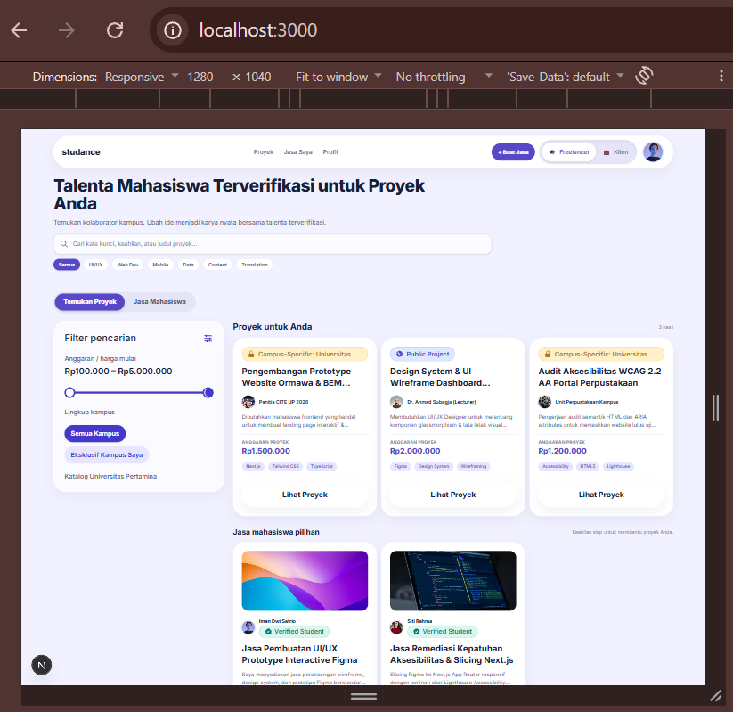
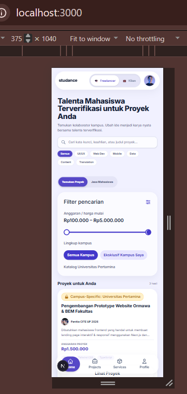
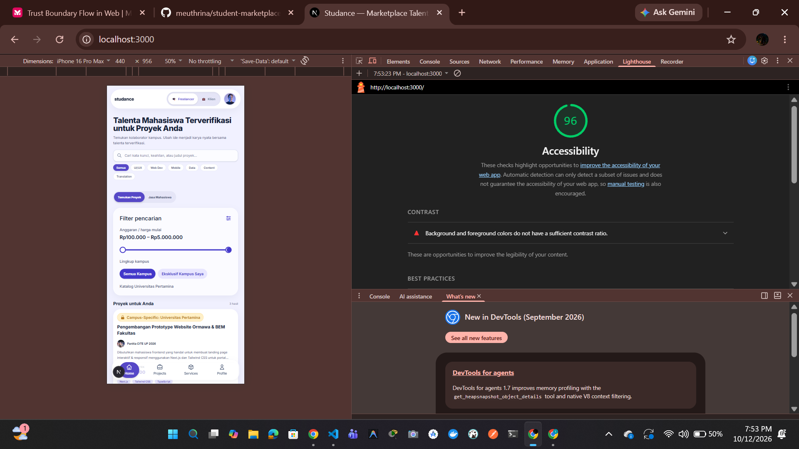
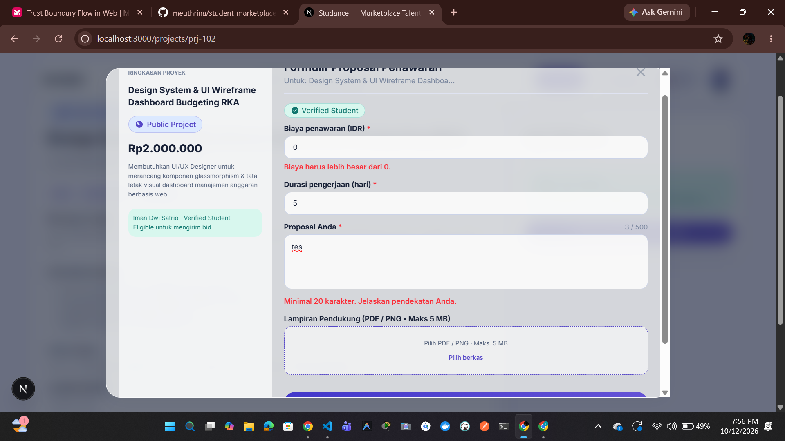
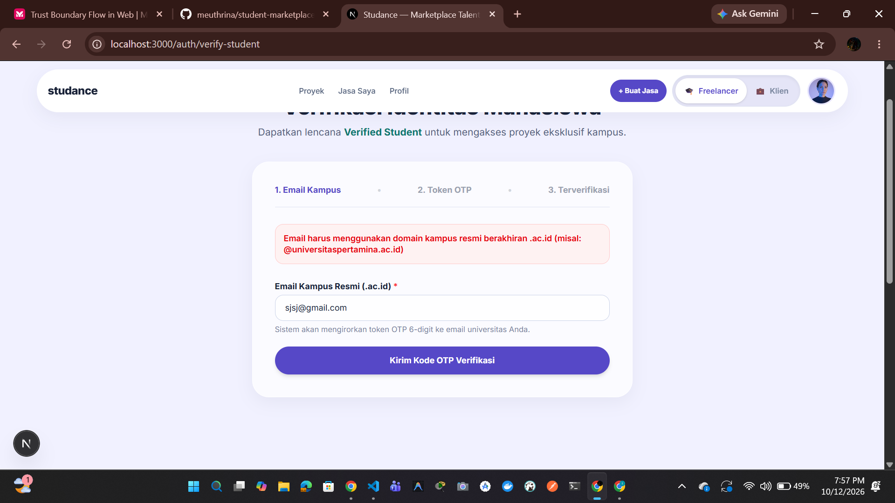

# Student Marketplace — Active Student Talent

Proyek terintegrasi semester 5 Universitas Pertamina:
1. **Pengembangan Aplikasi Web (52355)**
2. **Kriptografi (52357)**
3. **Keamanan Komputasi dan Siber (52353)**

## 🎓 Identitas Akademis
- **Nama:** Iman Dwi Satrio
- **NIM:** 105224029
- **Program Studi:** Ilmu Komputer, Universitas Pertamina

## 📂 Struktur Folder Proyek
- `/app` : Application Router, UI Components, & API (MK Web)
- `/lib/crypto` : Modul & fungsi Kriptografi (MK Kriptografi)
- `/security` : Threat Model STRIDE, DFD, Risk Register, & Audit Log (MK Cybersecurity)

## 🏷️ Version Tags
- `v0.1` : Tugas 1 Web Programming (UI & Mock Data)
- `crypto-v0.1` : Tugas 1 Kriptografi (Komponen Dasar Hashing)
- `sec-0.1` : Tugas 1 Cybersecurity (Threat Modeling STRIDE)

# Studance — Marketplace Talenta & Jasa Mahasiswa Terverifikasi (`v0.1`)


Studance adalah platform marketplace berbasis kampus yang menghubungkan mahasiswa aktif terverifikasi dengan proyek profesional, industri, dan peluang kolaborasi eksklusif.

---

## 🚀 Fitur Utama & Rute Antarmuka (`v0.1`)

1. **Beranda & Katalog Utama (`/`)**
   - Banner pencarian kata kunci dan kategori cepat.
   - Filter cakupan kampus (*Semua Kampus* vs *Eksklusif Kampus Saya*).
   - Katalog dinamis Proyek Klien dan Jasa Mandiri Mahasiswa.
2. **Detail Proyek & Formulir Proposal (`/projects/[id]`)**
   - Verifikasi kelayakan akses proyek berdasarkan domain kampus.
   - Modal interaktif pengajuan proposal penawaran (bidding) beserta validasi masukan.
3. **Verifikasi Mahasiswa Kampus (`/auth/verify-student`)**
   - Formulir validasi email resmi universitas (`.ac.id`).
   - Blok input 6-digit OTP token dengan proteksi simulasi *brute-force*.

---

## 🧩 Komponen Reusable (`components/`)

- `components/ui/VerifiedBadge.tsx`: Lencana mahasiswa terverifikasi.
- `components/ui/ScopeBadge.tsx`: Lencana cakupan proyek (*Campus-Specific* vs *Public*).
- `components/layout/Navbar.tsx`: Header melayang dengan *Context Role Switcher* (`[ 🎓 Freelancer | 💼 Klien ]`).
- `components/layout/MobileNav.tsx`: Bar navigasi bawah untuk layar seluler ($\le 640\text{px}$).
- `components/layout/Footer.tsx`: Penutup halaman berfitur *Trust Engine*.
- `components/features/projects/ProjectCard.tsx`: Kartu ringkasan proyek.
- `components/features/services/ServiceCard.tsx`: Kartu ringkasan jasa mahasiswa.

---

## 🛠️ Cara Menjalankan Proyek Secara Lokal

1. **Pengulangan Repositori & Instalasi Dependensi:**
   ```bash
   npm install

## 📸 Bukti Pengujian & Tangkapan Layar (Tugas 1 PAW Milestone v0.1)

### 1. Responsivitas Layar (Mobile, Tablet, Desktop)



### 2. Laporan Aksesibilitas Lighthouse (Skor >= 85)

*Kondisi Uji: Chrome v130+, Device Desktop, Halaman `/`, Skor Accessibility: 96/100.*

### 3. Validasi Formulir Sisi Klien & Pesan Kesalahan

