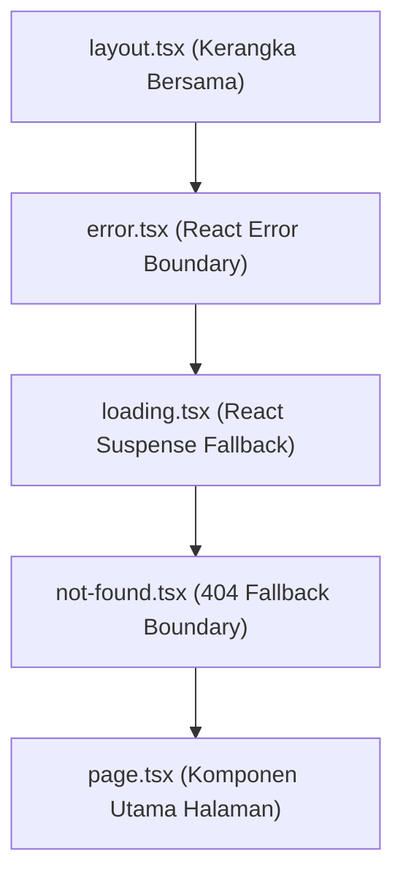

# Dokumentasi Analisis Komponen & Arsitektur Next.js 16 App Router

**Nama Produk:** Studance — Student Freelance Marketplace Platform  
**Institusi:** Universitas Pertamina  
**Mata Kuliah:** Pengembangan Aplikasi Web (PAW — Minggu 4 / v0.2 Step 1)  
**Kerangka Kerja:** Next.js 16 (App Router), React 19, TypeScript, Tailwind CSS  

---

## 1. Hirarki Struktur Rute Proyek Studance

Next.js 16 App Router menerapkan *file-based routing* berbasis folder di dalam direktori `app/`. Setiap folder merepresentasikan segmen URL, dan berkas `page.tsx` mendefinisikan titik masuk antarmuka yang dapat diakses publik.

```text
app/
├── layout.tsx                               # Root Layout (Server Component: <html>, <body>, Navbar, Footer)
├── not-found.tsx                            # Penanganan Global 404 (Server Component)
├── page.tsx                                 # Beranda (RSC: Agregasi data awal katalog proyek & jasa)
├── about/
│   └── page.tsx                             # Halaman Tentang Studance (RSC Statis)
├── profile/
│   └── page.tsx                             # Halaman Profil Mahasiswa/Klien (RSC)
├── masuk/
│   └── page.tsx                             # Rute Alternatif Masuk (RSC)
├── (auth)/                                  # Route Group Otentikasi (URL tanpa prefiks auth)
│   ├── login/
│   │   └── page.tsx                         # Halaman Masuk Akun (RSC pembungkus LoginForm)
│   ├── register/
│   │   └── page.tsx                         # Halaman Pendaftaran (RSC pembungkus RegisterForm)
│   └── auth/verify-student/
│       └── page.tsx                         # Halaman Verifikasi Email Kampus (.ac.id) & OTP
├── client/                                  # Segmen Manajemen Klien / Pemberi Kerja (DFD F3, F4, F9)
│   ├── error.tsx                            # Error Boundary Area Klien (Client Component, reset())
│   ├── dashboard/
│   │   └── page.tsx                         # Dashboard Ringkasan Proyek & Escrow (RSC)
│   └── projects/create/
│       ├── loading.tsx                      # Skeleton UI Saat Memuat Formulir Pasang Proyek
│       └── page.tsx                         # Formulir Pembuatan Proyek Baru (RSC pembungkus CreateProjectForm)
├── projects/                                # Segmen Katalog & Rincian Proyek Mahasiswa
│   ├── error.tsx                            # Error Boundary Segmen Proyek (Client Component, reset())
│   ├── layout.tsx                           # Layout Khusus Segmen Proyek (RSC)
│   ├── template.tsx                         # Template State Remount Segmen Proyek
│   ├── (catalog)/
│   │   ├── loading.tsx                      # Skeleton UI Katalog Kartu Proyek
│   │   └── page.tsx                         # Katalog Daftar Proyek Freelance (RSC)
│   └── [id]/                                # Rute Dinamis Detail Proyek (Promise params)
│       ├── loading.tsx                      # Skeleton UI Detail Proyek & Action Card
│       ├── not-found.tsx                    # Tampilan Khusus ID Proyek Tidak Ditemukan
│       └── page.tsx                         # Halaman Detail Proyek (RSC dengan validasi Zod & notFound())
└── services/                                # Segmen Katalog & Rincian Jasa Mahasiswa
    ├── loading.tsx                          # Skeleton UI Katalog Kartu Jasa
    ├── page.tsx                             # Katalog Daftar Jasa Mahasiswa (RSC)
    └── [id]/                                # Rute Dinamis Detail Jasa Mahasiswa
        ├── loading.tsx                      # Skeleton UI Detail Jasa & Portofolio
        ├── not-found.tsx                    # Tampilan Khusus ID Jasa Tidak Ditemukan
        └── page.tsx                         # Halaman Detail Jasa (RSC dengan notFound())
```

---

## 2. Tabel Pemilahan Komponen (Server Component vs Client Component)

Sesuai prinsip perancangan Next.js App Router: **"Jalankan sebanyak mungkin di server, jadikan Client Component hanya pada elemen daun yang benar-benar membutuhkan interaktivitas (*Leaf Components*)."**

Semua halaman `page.tsx` diimplementasikan sebagai **async Server Component** untuk mengamankan kueri data, mempercepat *First Contentful Paint* (FCP), dan mengurangi ukuran bundel JavaScript klien.

| No | Nama Berkas / Komponen | Tipe Lingkungan | Alasan Teknis & Pertimbangan Desain |
|---|---|---|---|
| 1 | `app/layout.tsx` | **Server Component** | Kerangka akar aplikasi statis (`<html>`, `<body>`, font Google Sans, metadata global). Tidak memiliki state reaktif sehingga tidak memerlukan bundle JS klien. |
| 2 | `app/page.tsx` | **Server Component** | Menyiapkan data awal katalog (`mockProjects`, `mockServices`) di server dan mengirimkannya sebagai serializable props ke komponen interaktif tanpa mengekspos logic database ke browser. |
| 3 | `app/projects/[id]/page.tsx` | **Server Component** | Mengekstrak `params` asinkron (`await params`), memvalidasi skema ID via Zod (`projectIdSchema`), dan memicu `notFound()` secara langsung di server untuk menghasilkan status HTTP 404 asli. |
| 4 | `app/client/dashboard/page.tsx` | **Server Component** | Menghitung metrik analitik (proyek aktif, total proposal masuk, saldo komitmen escrow) langsung di server; rendering murni tanpa ketergantungan hook browser. |
| 5 | `app/client/projects/create/page.tsx` | **Server Component** | Menyajikan struktur halaman, breadcrumb, dan panduan keamanan DFD F3 di sisi server, serta mendelegasikan formulir masukan ke komponen daun `CreateProjectForm`. |
| 6 | `components/features/client/CreateProjectForm.tsx` | **Client Component (`"use client"`)** | Mengelola status interaktif pengiriman form dengan hook React 19 `useActionState(simpanProyek, {})`, penanganan validasi inline field, dan status loading `isPending`. |
| 7 | `components/features/projects/ProjectCard.tsx` | **Server Component** | Komponen presentasional murni untuk merender kartu proyek. Menggunakan elemen `<Link>` Next.js untuk navigasi tanpa membutuhkan event handler JavaScript `onClick`. |
| 8 | `components/features/projects/ProjectDetailClient.tsx` | **Client Component (`"use client"`)** | Mengelola state buka-tutup modal penawaran proposal (`isModalOpen`) menggunakan hook `useState` dan menangani event klik pengguna pada tombol aksi. |
| 9 | `components/features/projects/ProposalBidForm.tsx` | **Client Component (`"use client"`)** | Menangani formulir penawaran proposal harga, durasi, dan unggahan lampiran portofolio dengan event `onSubmit`, `onChange`, validasi ukuran berkas 5MB, serta state interaktif lokal. |
| 10 | `components/features/projects/ProposalModal.tsx` | **Client Component (`"use client"`)** | Membutuhkan manipulasi DOM dialog modal, penutupan via tombol ESC/backdrop (`onClose`), dan penguncian scroll latar belakang menggunakan hook `useState` dan event listener. |
| 11 | `components/features/services/ServiceCard.tsx` | **Server Component** | Komponen presentasional murni untuk kartu katalog jasa mahasiswa. Tidak menggunakan React hooks atau event handler, sehingga bebas bundle JS klien. |
| 12 | `components/features/services/ServiceContactModal.tsx` | **Client Component (`"use client"`)** | Modal interaktif formulir kontak langsung ke freelancer mahasiswa dengan pengendalian state lokal `isOpen`, `pesan`, dan event submit. |
| 13 | `components/features/auth/LoginForm.tsx` | **Client Component (`"use client"`)** | Menangani masukan form kredensial pengguna, state loading `isPending`, toggle visibilitas kata sandi, dan integrasi validasi masukan otentikasi. |
| 14 | `components/features/auth/VerifyStudentWizard.tsx` | **Client Component (`"use client"`)** | Mengatur multi-step wizard verifikasi identitas kampus, perpindahan fokus otomatis kotak OTP 6-digit via DOM `getElementById`, dan pemanggilan Server Action kriptografi HMAC. |
| 15 | `components/features/home/HomeClientCatalog.tsx` | **Client Component (`"use client"`)** | Menampung state reaktif pencarian kata kunci, pemilihan scope kampus (Semua vs Universitas Pertamina), dan slider filter anggaran menggunakan custom hook `useProjectFilter`. |
| 16 | `components/layout/NavbarLinks.tsx` | **Client Component (`"use client"`)** | Memanfaatkan hook `usePathname()` dari `next/navigation` untuk mendeteksi rute URL aktif secara dinamis dan menyematkan atribut aksesibilitas `aria-current="page"`. |
| 17 | `components/layout/Footer.tsx` | **Client Component (`"use client"`)** | Menggunakan `usePathname()` untuk menyembunyikan footer pada rute beranda (`/`) dan menampilkan variasi footer kompak pada rute detail proyek/jasa. |
| 18 | `components/ui/VerifiedBadge.tsx` | **Server Component** | Komponen desain atomik presentasional murni penanda status verifikasi mahasiswa. Tidak memerlukan state atau event interaktif. |
| 19 | `components/ui/ScopeBadge.tsx` | **Server Component** | Komponen visual atomik pembeda cakupan proyek (`PUBLIC` vs `CAMPUS_SPECIFIC`). Merender teks dan ikon tanpa beban komputasi klien. |
| 20 | `components/ui/GlassCard.tsx` | **Server Component** | Kontainer kontur kaca *Liquid Glass* semantik HTML5 (`<div>` atau `<article>`). Bersifat presentasional murni tanpa dependensi hook browser. |

---

## 3. Mekanisme Penanganan Kondisi Khusus (Special Files)

Next.js 16 App Router menyediakan berkas konvensi khusus per segmen rute yang dibungkus secara hierarkis (dari luar ke dalam: `<layout>` → `<error>` → `<loading>` → `<not-found>` → `<page>`).



### A. `loading.tsx` (Streaming UI & React Suspense)
- **Tujuan:** Menampilkan umpan balik visual instan (*skeleton placeholder*) saat segmen rute atau kueri data asinkron sedang diproses di server.
- **Mekanisme Otomatis:** Next.js secara otomatis membungkus berkas `page.tsx` ke dalam boundary `<Suspense fallback={<Loading />}>`. Dengan demikian, `layout.tsx` (seperti Navbar dan Footer) tetap interaktif dan tidak berkedip (*zero layout shift*).
- **Implementasi pada Studance:**
  * `app/projects/(catalog)/loading.tsx`: Menampilkan skeleton grid 6 kartu proyek.
  * `app/projects/[id]/loading.tsx`: Menampilkan skeleton detail proyek (breadcrumb, kartu informasi proyek di kolom kiri, dan kartu aksi penawaran di kolom kanan).
  * `app/services/loading.tsx`: Menampilkan skeleton tab filter kategori dan kartu jasa 3-kolom.
  * `app/services/[id]/loading.tsx`: Menampilkan skeleton profil freelancer dan portofolio.
  * `app/client/projects/create/loading.tsx`: Menampilkan skeleton formulir masukan proyek dan panduan DFD F3.

### B. `error.tsx` (Error Boundary Isolatif)
- **Tujuan:** Menangkap galat tak terduga (*runtime exception*) pada segmen halaman beserta seluruh anak komponennya tanpa merusak seluruh aplikasi (*graceful degradation*).
- **Aturan Ketat:**
  1. Wajib bertanda direktif `'use client'` karena harus mengeksekusi metode pemulihan interaktif di browser.
  2. Menerima props `{ error: Error & { digest?: string }, reset: () => void }`.
  3. **Keamanan Siber & OWASP Top 10:** Dilarang keras membocorkan pesan galat teknis internal, path direktori server, query database, atau *stack trace* ke layar pengguna. Cukup tampilkan pesan yang ramah pengguna serta kode referensi `digest` untuk penelusuran log internal.
- **Implementasi pada Studance:**
  * `app/projects/error.tsx`: Menangkap kegagalan pengambilan data proyek dengan tombol `Coba Muat Ulang` yang memicu re-render melalui `reset()`.
  * `app/client/error.tsx`: Menangkap galat di area manajemen klien/dashboard dengan opsi coba ulang atau navigasi kembali ke `/client/dashboard`.

### C. `not-found.tsx` (Penanganan Entitas Tidak Tersedia)
- **Tujuan:** Menampilkan antarmuka penjelas saat entitas yang dicari tidak ditemukan dalam basis data atau ketika pengguna mengakses URL yang tidak terdaftar.
- **Pemicu:** Dipicu secara terprogram melalui fungsi `notFound()` dari modul `next/navigation`.
- **Implementasi pada Studance:**
  * `app/not-found.tsx` (Global): Menangkap semua URL yang tidak cocok dengan segmen rute mana pun dan mengembalikan status HTTP 404 yang sah dengan tautan kembali ke Beranda.
  * `app/projects/[id]/not-found.tsx`: Aktif ketika ID proyek gagal divalidasi oleh Zod atau tidak ditemukan di basis data/Prisma, memberikan pesan informatif bahwa proyek mungkin sudah ditutup atau tautan salah.
  * `app/services/[id]/not-found.tsx`: Aktif ketika ID jasa tidak terdaftar pada katalog talenta mahasiswa.

---

## 4. Kepatuhan Standar Next.js 16 & Best Practices

1. **Parameter Rute Asinkron (Async `params`):**
   Pada Next.js 16, nilai `params` dan `searchParams` diperlakukan sebagai Promise. Seluruh segmen dinamis Studance (`app/projects/[id]/page.tsx` dan `app/services/[id]/page.tsx`) telah meng-await parameter sebelum digunakan:
   ```typescript
   const { id } = await params;
   ```
2. **Navigasi Sisi Klien:**
   Seluruh navigasi internal menggunakan komponen `<Link>` dari `next/link` atau hook `useRouter` dari `next/navigation`. Tidak ditemukan penggunaan modul usang `next/router` (Pages Router) maupun tag tautan konvensional `<a>` untuk tautan internal.
3. **Pemisahan Logika Server & Rahasia:**
   Seluruh proses pembentukan dan validasi tanda tangan kriptografi (HMAC-SHA256) diisolasi di sisi server melalui Server Actions (`app/actions/verifyStudent.ts` dan `app/client/projects/actions.ts`), sehingga variabel rahasia seperti `STUDENT_VERIFICATION_SECRET` tidak pernah terkompilasi ke bundel JavaScript peramban klien.

