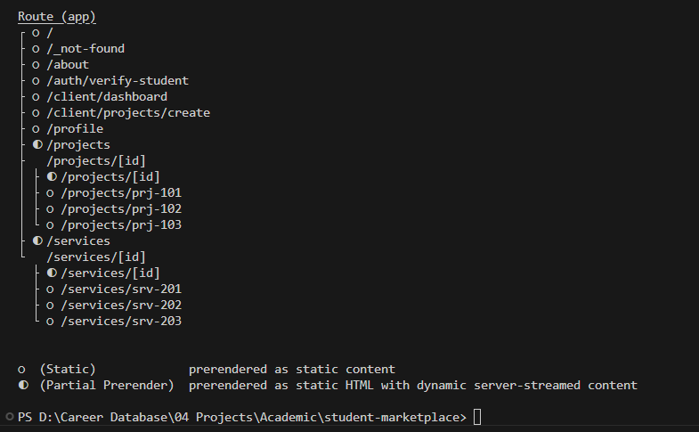
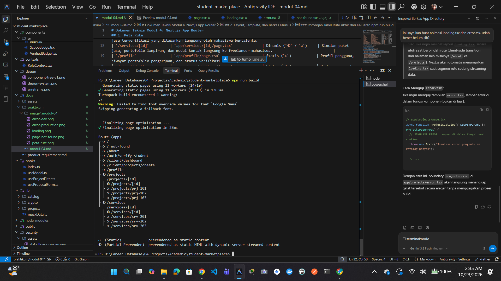
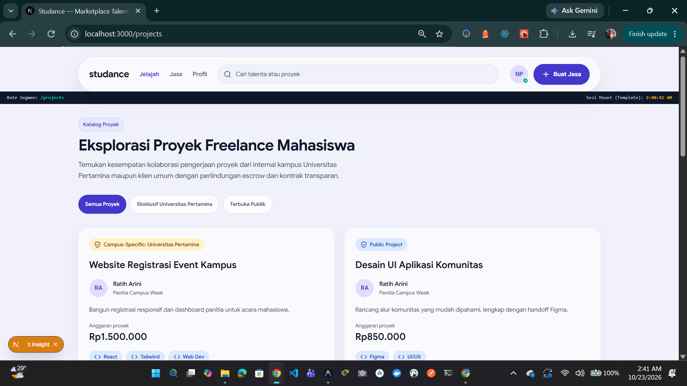
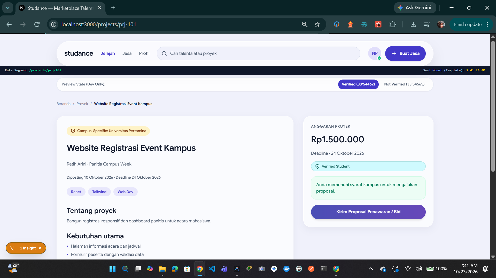
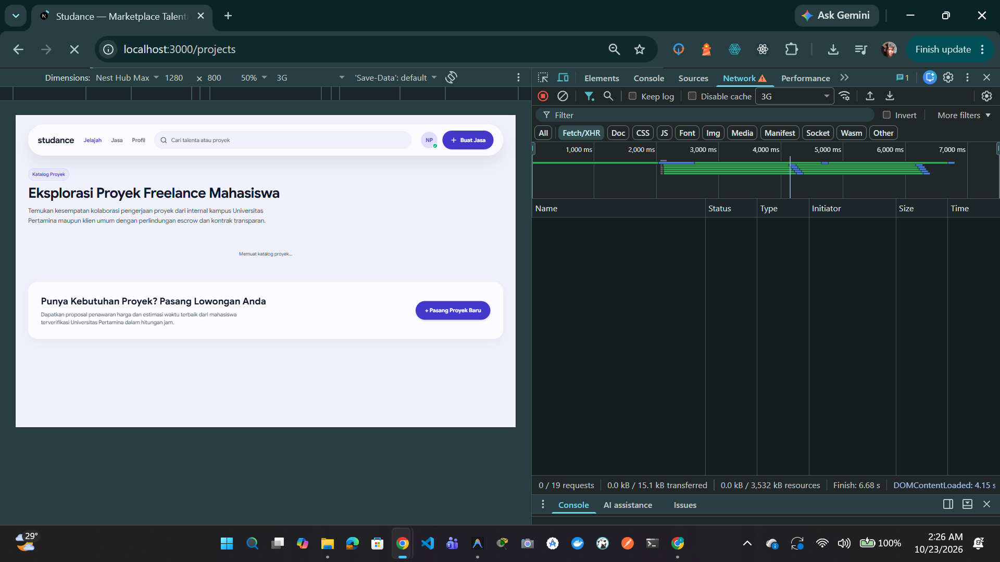
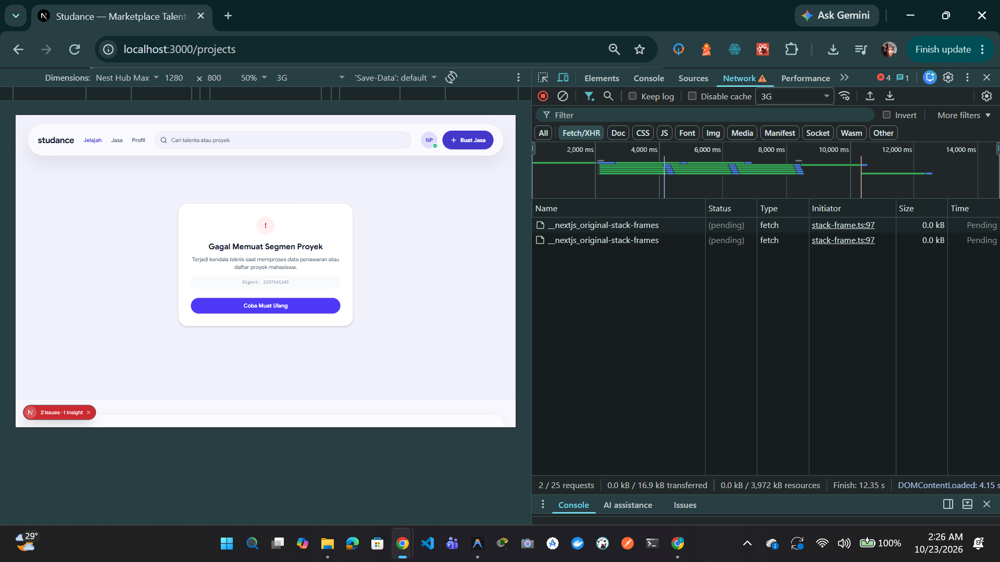
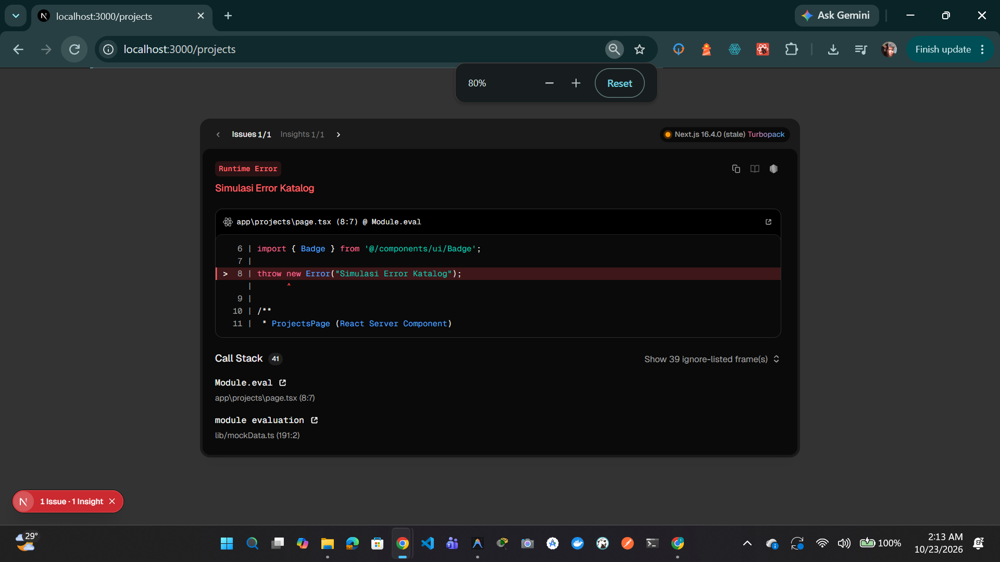
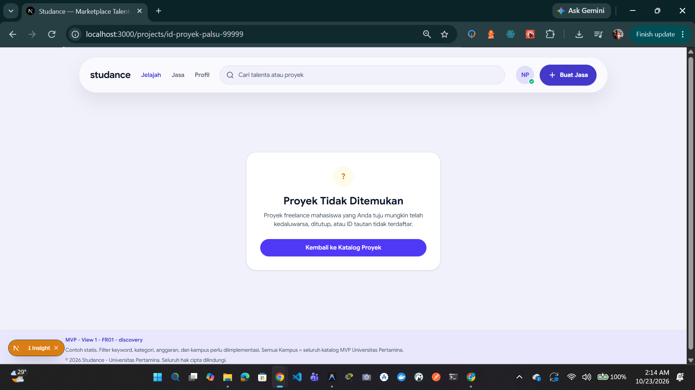
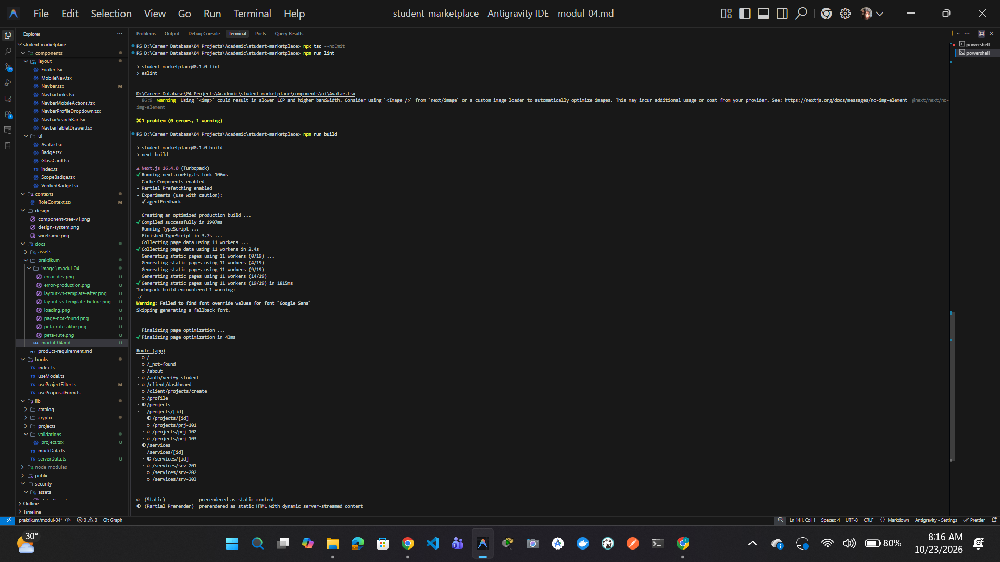

# Dokumen Teknis Modul 4: Next.js App Router

Nama/NIM : Iman Dwi Satrio / 105224029
Repositori : https://github.com/meuthrina/student-marketplace
Versi Next.js dan mode Cache Components (aktif/tidak) : aktif

## 1. Peta Rute

Berikut adalah pemetaan rute berbasis berkas (file-based routing) pada platform **Studance (Student Freelance Marketplace)** yang telah terverifikasi melalui build produksi:

| URL                       | Berkas di `app/`                          | Jenis Rute              | Isi Halaman & Kontribusi Alur Produk                                                                                    |
| ------------------------- | ----------------------------------------- | ----------------------- | ----------------------------------------------------------------------------------------------------------------------- |
| `/`                       | `app/page.tsx`                            | Statis (`○`)            | Beranda utama marketplace, hero banner, dan katalog kurasi proyek/jasa terpopuler.                                      |
| `/about`                  | `app/about/page.tsx`                      | Statis (`○`)            | Informasi visi platform Studance, model verifikasi mahasiswa, dan perlindungan transaksi.                               |
| `/projects`               | `app/projects/page.tsx`                   | Partial Prerender (`◐`) | Katalog penjelajahan proyek freelance dengan filter dinamis scope institusi dan kategori keahlian.                      |
| `/projects/[id]`          | `app/projects/[id]/page.tsx`              | Dinamis (`◐` / `○`)     | Detail spesifikasi pekerjaan, tenggat waktu, anggaran, serta formulir pengajuan proposal penawaran (DFD F1/F4).         |
| `/services`               | `app/services/page.tsx`                   | Partial Prerender (`◐`) | Direktori katalog jasa terverifikasi yang ditawarkan langsung oleh mahasiswa bertalenta.                                |
| `/services/[id]`          | `app/services/[id]/page.tsx`              | Dinamis (`◐` / `○`)     | Rincian paket jasa, portofolio lampiran, dan modal kontak langsung ke freelancer mahasiswa.                             |
| `/profile`                | `app/profile/page.tsx`                    | Statis (`○`)            | Profil pengguna, riwayat portofolio pengerjaan, dan status verifikasi kampus personal.                                  |
| `/client/dashboard`       | `app/client/dashboard/page.tsx`           | Statis (`○`)            | Dasbor terpusat klien untuk memantau status proyek aktif dan dana escrow (DFD F3/F9).                                   |
| `/client/projects/create` | `app/client/projects/create/page.tsx`     | Statis (`○`)            | Formulir penerbitan proyek baru oleh klien dengan opsi scope internal kampus atau publik.                               |
| `/auth/verify-student`    | `app/(auth)/auth/verify-student/page.tsx` | Statis (`○`)            | Alur onboarding verifikasi mahasiswa via email kampus `@student.universitaspertamina.ac.id` dan token HMAC (DFD F5-F7). |

### Potongan Tabel Rute dari Keluaran `npm run build`



## 2. Layout, Template, dan Berkas Khusus

### Potongan Tabel Rute Akhir dari Keluaran `npm run build`



- **Hasil uji layout vs template (tangkapan layar sebelum dan sesudah navigasi)**:
  - Sebelum Navigasi (Input terisi pada Layout dan Template):
    
  - Sesudah Navigasi (State Template ter-reset, State Layout bertahan):
    

- **Tangkapan layar loading.tsx dan error.tsx (mode dev dan produksi)**:
  - Tampilan Loading State (`app/projects/loading.tsx`):
    
  - Tampilan Error Boundary Mode Dev (Dev Overlay):
    
  - Tampilan Error Boundary Mode Produksi (`app/projects/error.tsx`):
    
  - Tampilan Not Found (`app/projects/[id]/not-found.tsx`):
    

## 3. Rute Dinamis dan Validasi params

### Tabel Uji Validasi URL

Pengujian dilakukan menggunakan antarmuka baris perintah `curl.exe -I` terhadap lingkungan server lokal untuk memvalidasi kepatuhan siklus request-response HTTP dan kode status semantik pada rute dinamis:

| URL Tujuan                                | Hasil yang Diharapkan                                       | Hasil Aktual                                                   | Kode Status `curl` |
| :---------------------------------------- | :---------------------------------------------------------- | :------------------------------------------------------------- | :----------------: |
| `http://localhost:3000/projects/prj-101`  | Menampilkan detail spesifikasi proyek terdaftar secara utuh | Merender halaman spesifikasi pekerjaan valid                   |      `200 OK`      |
| `http://localhost:3000/projects/abc`      | Validasi skema Zod gagal, memicu `notFound()` seketika      | Dialihkan ke tampilan kustom `app/projects/[id]/not-found.tsx` |  `404 Not Found`   |
| `http://localhost:3000/projects/prj-999`  | Format skema valid tetapi entitas tidak ada di data store   | Memanggil `notFound()` dan menyajikan UI 404 segmen            |  `404 Not Found`   |
| `http://localhost:3000/halaman-tidak-ada` | URL tidak terdaftar pada peta rute aplikasi Studance        | Menampilkan antarmuka `app/not-found.tsx` tingkat global       |  `404 Not Found`   |

### Penjelasan Aturan Validasi params

Validasi parameter rute pada berkas `app/projects/[id]/page.tsx` dirancang dengan prinsip _Defense in Depth_ dan standar arsitektur Next.js 16 App Router:

1. **Resolusi Asinkron Parameter (`Promise-based params`)**:
   Sesuai kaidah Next.js versi mutakhir, properti `params` dievaluasi sebagai objek asinkron (`Promise<{ id: string }>`). Nilai parameter diekstrak menggunakan `const { id } = await params;` sebelum dialirkan ke tahap evaluasi logika backend atau layer basis data.

2. **Validasi Masukan Berbasis Skema (`Zod Schema Validation`)**:
   Alih-alih sekadar pengecekan prefiks string statis, parameter `id` divalidasi secara ketat menggunakan skema Zod (`projectIdSchema`):
   ```typescript
   export const projectIdSchema = z
     .string()
     .trim()
     .refine(
       (val) =>
         /^prj-\d+$/.test(val) || z.string().uuid().safeParse(val).success,
       { message: "Format ID proyek tidak valid" },
     );
   ```

## 4. Pembagian Server dan Client Components

### Tabel Pembagian Komponen

| Komponen / Berkas                 | Jenis Komponen                    | Alasan Teknis & Batasan Arsitektural                                                                                                               |
| :-------------------------------- | :-------------------------------- | :------------------------------------------------------------------------------------------------------------------------------------------------- |
| `app/projects/(catalog)/page.tsx` | Server Component                  | Mengambil data katalog proyek di sisi server (SSR), menjaga efisiensi zero-bundle-size, dan mengamankan query awal dari paparan publik (DFD T32).  |
| `app/projects/[id]/page.tsx`      | Server Component                  | Melakukan validasi parameter via Zod dan lookup entitas; melempar status HTTP 404 murni via `notFound()` sebelum render dilakukan.                 |
| `app/projects/layout.tsx`         | Server Component                  | Bertindak sebagai persistent shell bersama tanpa me-remount sub-elemen antar-navigasi rute anak.                                                   |
| `app/projects/template.tsx`       | Client Component (`"use client"`) | Memerlukan React hook (`usePathname`, `useEffect`, `useState`) untuk me-reset lifecycle halaman dan audit log sesi navigasi saat berpindah segmen. |
| `ProjectDetailClient.tsx`         | Client Component (`"use client"`) | Menangani interaktivitas antarmuka: tab navigasi, event klik modal pengajuan proposal/bid, serta input interaktif pengguna di browser (T31).       |
| `ProjectActionCard.tsx`           | Client Component (`"use client"`) | Mengelola interaksi aksi penawaran dan status ketersediaan berbasis event browser.                                                                 |

### Hasil Uji Impor `server-only` dari Client Component

- **Skenario Uji**: Mengimpor modul internal database/rahasia (`lib/serverData.ts`) yang diproteksi `import 'server-only';` ke dalam berkas Client Component (`components/features/projects/ProjectDetailClient.tsx`).
- **Tujuan Pengujian**: Memastikan keamanan rantai data (Data Store T33) tidak bocor ke bundle JavaScript peramban publik (T31) sesuai prinsip Defense in Depth OWASP Top 10 A05 (Security Misconfiguration / Information Disclosure).
- **Pesan Galat Kompilasi (Next.js Build Failure)**:

```text
Error: Turbopack build failed with 2 errors:
./lib/serverData.ts:1:1
Error: 'server-only' cannot be imported from a Client Component module
> 1 | import 'server-only';
    | ^^^^^^^^^^^^^^^^^^^^^
  2 |
  3 | /**
  4 |  * Modul Data Internal Server (Simulasi Akses Database/Secret Key)

It should only be used from a Server Component.

Import traces:
  Client Component Browser:
    ./lib/serverData.ts [Client Component Browser]
    ./components/features/projects/ProjectDetailClient.tsx [Client Component Browser]
    ./components/features/projects/ProjectDetailClient.tsx [Server Component]
    ./app/projects/[id]/page.tsx [Server Component]

  Client Component SSR:
    ./lib/serverData.ts [Client Component SSR]
    ./components/features/projects/ProjectDetailClient.tsx [Client Component SSR]
    ./components/features/projects/ProjectDetailClient.tsx [Server Component]
    ./app/projects/[id]/page.tsx [Server Component]
```

- **Kesimpulan Keamanan**:
  Kompilator Next.js (Turbopack) secara deterministik menghentikan proses _build_ produksi dan menolak pembuatan bundel klien ketika terdeteksi adanya modul berlabel `server-only`. Hal ini menjamin kredensial koneksi basis data, kunci privat API, dan logika _data-layer_ terlindungi secara absolut di lingkungan server runtime tanpa risiko terekspos ke sisi publik peramban.

## 5. Verifikasi



## 6. Kendala dan Penyelesaian

Selama perancangan arsitektur dan implementasi Modul 4 pada platform _Studance_, ditemukan beberapa kendala teknis tingkat lanjut beserta langkah penyelesaian terukurnya:

1. **Munculnya Respons HTTP Status 200 OK Palsu (_Soft 404_) pada Pengujian Rute Dinamis**:
   - _Kendala_: Ketika rute dinamis yang tidak terdaftar (`/projects/abc` dan `/projects/prj-999`) diuji menggunakan `curl.exe -I`, server mengembalikan status `HTTP/1.1 200 OK` dengan _header_ `x-nextjs-prerender: 1`, padahal fungsi `notFound()` telah dipanggil.
   - _Akar Masalah_: Keberadaan berkas `app/projects/loading.tsx` di tingkat segmen induk secara otomatis membungkus seluruh subrute di bawahnya (termasuk rute anak `[id]`) ke dalam _streaming boundary_ `<Suspense>`[cite: 8, 12]. Next.js mengirimkan _initial HTTP response header_ `200 OK` bersama _skeleton loading_ ke peramban sebelum eksekusi evaluasi Server Component selesai.
   - _Penyelesaian_: Memindahkan halaman katalog dan berkas pemuatannya ke dalam Route Group `app/projects/(catalog)/page.tsx` dan `app/projects/(catalog)/loading.tsx`. Dengan pola ini, halaman detail `app/projects/[id]/page.tsx` terbebas dari _Suspense boundary_ induk, sehingga validasi skema masukan Zod dan pemanggilan `notFound()` di tingkat Server Component terluar berhasil mengembalikan status murni `HTTP/1.1 404 Not Found` pada protokol jaringan.

2. **Galat Internal Server (HTTP 500) Akibat Deklarasi `dynamicParams = false`**:
   - _Kendala_: Penambahan konfigurasi `export const dynamicParams = false;` menyebabkan rute dinamis mengalami _fatal prerender crash_ (HTTP 500) saat menerima parameter di luar `generateStaticParams()`.
   - _Akar Masalah_: Terjadi benturan antara pembatasan parameter statis kaku pada level router dengan evaluasi logika asinkron `await params` di dalam Server Component pada Next.js 16.
   - _Penyelesaian_: Menghapus deklarasi `dynamicParams = false` dan menyerahkan kendali penolakan sepenuhnya kepada skema Zod (`projectIdSchema`) serta pemanggilan terprogram `notFound()` di Server Component terluar. Hal ini menjaga sifat dinamis marketplace sekaligus menegakkan sanitasi masukan (_input sanitization_).

3. **Pelanggaran Aturan Linting React 19 / ESLint Next.js 16 (`react-hooks/set-state-in-effect`)**:
   - _Kendala_: Perintah `npm run lint` menghasilkan serangkaian galat pada komponen `template.tsx`, `ProposalModal.tsx`, `Navbar.tsx`, `RoleContext.tsx`, dan `useProjectFilter.ts` akibat pemanggilan `setState` sinkron di dalam `useEffect`.
   - _Akar Masalah_: Paradigma React 19 melarang mutasi _state_ sinkron langsung di dalam efek samping karena dapat memicu _cascading re-renders_ dan merusak prediktabilitas _render tree_.
   - _Penyelesaian_:
     - Pada `app/projects/template.tsx`, pembaruan _state session mount_ dialihkan ke eksekusi makrotask asinkron via `setTimeout` yang dilengkapi _cleanup function_ `clearTimeout`.
     - Pada `RoleContext.tsx`, state redundan dieliminasi dan digantikan dengan _derived state_ murni memanfaatkan `useMemo`.
     - Pada `Navbar.tsx` dan `useProjectFilter.ts`, logika efek samping diubah mengikuti pola resmi React _adjusting state during rendering_ berbasis perbandingan nilai parameter sebelumnya.

4. **Verifikasi Keamanan Batas Isolasi Server (`server-only`)**:
   - _Kendala_: Memastikan bahwa modul data internal dan fungsi kriptografis pada lingkungan T32/T33 tidak dapat bocor ke bundel JavaScript peramban publik (T31).
   - _Penyelesaian_: Menerapkan paket `server-only` pada modul internal (`lib/serverData.ts`) dan melakukan uji coba destruktif dengan mengimpor modul tersebut ke dalam Client Component (`ProjectDetailClient.tsx`). Kompiler Turbopack berhasil mendeteksi pelanggaran batas arsitektur dan menghentikan proses _build_, membuktikan bahwa mekanisme _Defense in Depth_ (OWASP Top 10 A05) berfungsi efektif.

---

## 7. Catatan Pemanfaatan AI

Pemanfaatan asisten kecerdasan artifisial dilakukan secara bertanggung jawab dan terukur untuk mendukung percepatan analisis, pelacakan akar masalah arsitektur, dan perbaikan sintaks kode tanpa mengurangi pemahaman konseptual mandiri:

- **Alat**: Gemini (sebagai Full Project Mentor) dan Antigravity Agent IDE CLI (eksekusi pengujian lokal).
- **Perintah Utama (Prompts)**:
  1. _"Periksa implementasi rute dinamis dan data layer pada repositori: bagaimana penanganan params, pemanggilan notFound(), dan skema data ID?"_
  2. _"Perbaiki rute dinamis app/projects/[id]/page.tsx agar mengembalikan header HTTP 404 murni (bukan 200 OK atau 500 Error) saat diuji menggunakan curl.exe -I."_
  3. _"Lakukan observasi komponen server vs client, lakukan uji coba impor modul server-only ke Client Component, rekam log galat kompilasi resmi Next.js, dan bersihkan kembali kode."_
  4. _"Analisis dan perbaiki seluruh pelanggaran linting React 19 (react-hooks/set-state-in-effect) pada modul template, modal penawaran, context, dan custom hooks sesuai pola idiomatik React."_
- **Bagian yang Digunakan**:
  - Investigasi akar masalah _Soft 404_ akibat penempatan `<Suspense>` bawaan pada `loading.tsx`.
  - Penyusunan skema validasi Zod (`projectIdSchema`) untuk mendukung pola pengenal _mock_ sekaligus kesiapan format UUID v4.
  - Refaktorisasi pola sinkronisasi _state_ komponen antarmuka agar mematuhi aturan ESLint React 19.
  - Pengujian empiris batas keamanan isolasi modul `server-only` dari paparan lingkungan klien (DFD T31 $\leftrightarrow$ T32).
- **Cara Memverifikasinya**:
  - Melakukan inspeksi kode manual (_code review_) baris demi baris pada setiap berkas yang diubah oleh asisten AI.
  - Menjalankan pengujian jaringan HTTP langsung menggunakan perintah `curl.exe -I` untuk memastikan kode status `200 OK` dan `404 Not Found` terkirim secara semantik pada rute terkait.
  - Menjalankan uji batas kompilasi produksi via `npm run build` untuk memvalidasi penolakan modul `server-only` oleh Turbopack.
  - Memastikan integritas kode akhir melalui eksekusi `npx tsc --noEmit` (_0 errors_) dan `npm run lint` (_0 errors_) pada terminal lokal.
