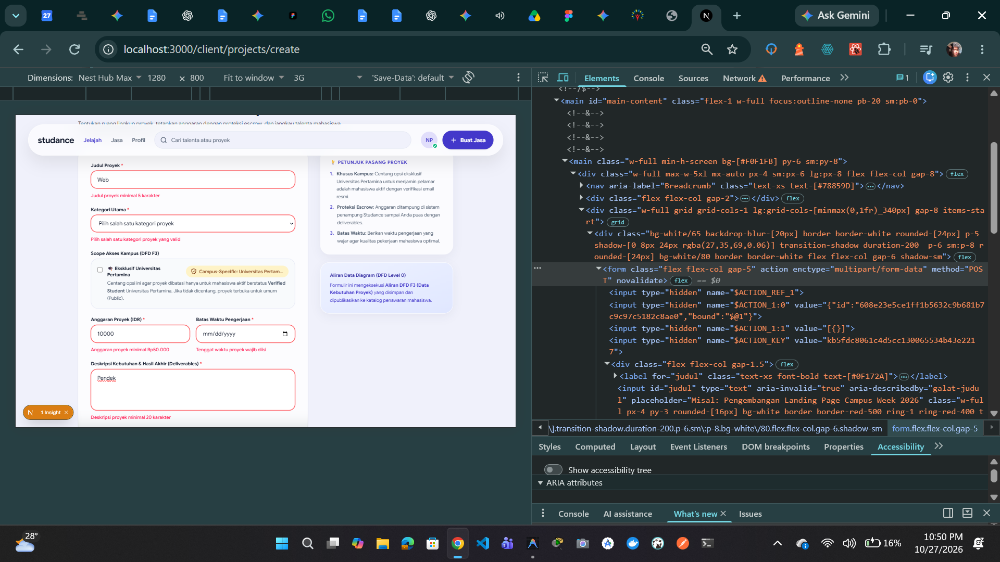
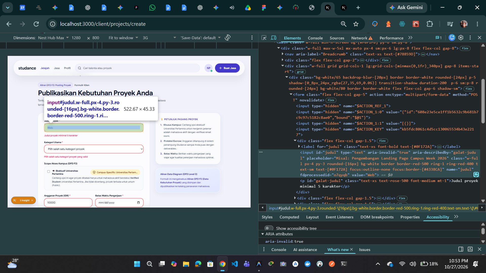
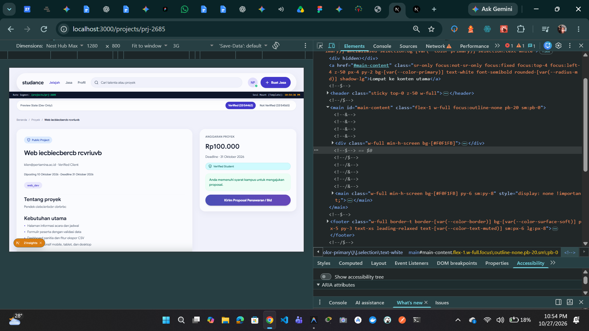
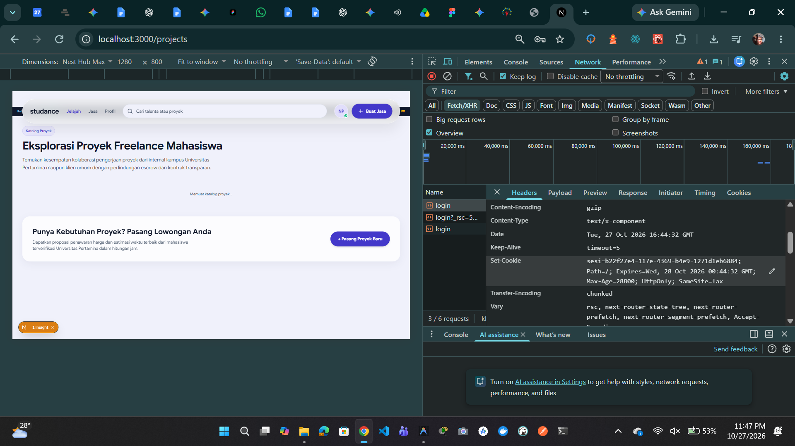
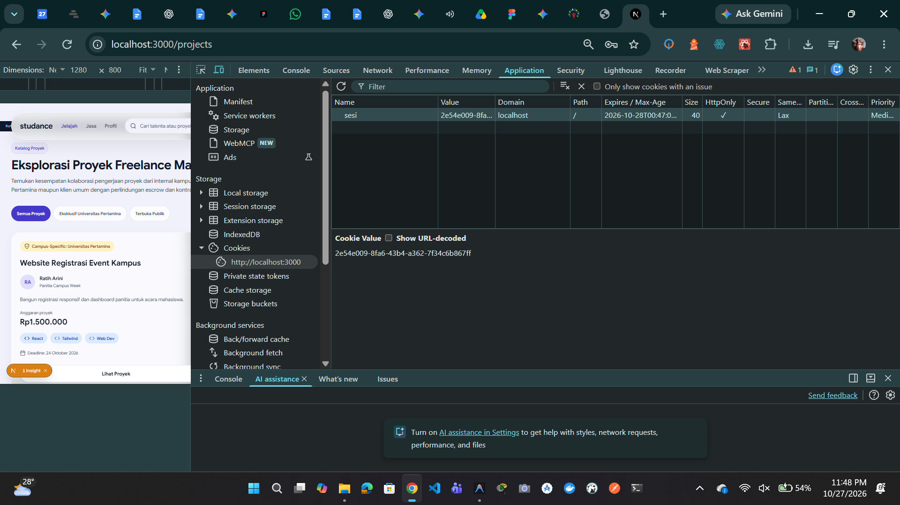

# Dokumen Teknis Modul 5: Formulir, Validasi, Session, dan Cookie

**Nama/NIM** : Iman Dwi Satrio / 105224029  
**Repositori** : `https://github.com/meuthrina/student-marketplace`  
**Produk** : Studance (Student Freelance Marketplace)

## 1. Skema Validasi

### Tabel Kolom Formulir Utama Produk

Formulir utama yang diuji adalah formulir penerbitan proyek baru oleh klien (`app/client/projects/create/page.tsx`). Validasi bentuk/sintaksis didefinisikan secara deklaratif menggunakan skema Zod 4 pada berkas `lib/skema.ts`:

| Nama Kolom        | Elemen HTML               | Aturan Zod 4                                                                        | Pesan Galat Spesifik                                                                   |
| :---------------- | :------------------------ | :---------------------------------------------------------------------------------- | :------------------------------------------------------------------------------------- |
| `judul`           | `<input type="text">`     | `z.string().trim().min(5).max(100)`                                                 | "Judul proyek minimal 5 karakter" / "Judul proyek maksimal 100 karakter"               |
| `kategori`        | `<select>`                | `z.enum(['web_dev', 'mobile_dev', 'ui_ux', 'academic_research'], { error: '...' })` | "Pilih salah satu kategori proyek yang valid"                                          |
| `anggaran`        | `<input type="number">`   | `z.coerce.number({ error: '...' }).min(50000)`                                      | "Anggaran harus berupa angka valid" / "Anggaran proyek minimal Rp50.000"               |
| `tenggatWaktu`    | `<input type="date">`     | `z.string().min(10)`                                                                | "Tenggat waktu proyek wajib diisi"                                                     |
| `deskripsi`       | `<textarea>`              | `z.string().trim().min(20).max(1000)`                                               | "Deskripsi proyek minimal 20 karakter" / "Deskripsi proyek maksimal 1000 karakter"     |
| `eksklusifKampus` | `<input type="checkbox">` | `z.stringbool().default(false)`                                                     | Format boolean tidak valid (mengubah "on" menjadi `true`, absen kunci menjadi `false`) |
| `keahlian`        | `<input type="text">`     | `z.string().optional()`                                                             | Bersifat opsional (dipisahkan tanda koma untuk _tagging_ keahlian mahasiswa)           |

---

### Aturan Semantik yang Diperiksa di Server Action dan Alasannya

Skema Zod hanya bertugas melakukan validasi bentuk atau sintaksis masukan (_syntactic validation_) pada lapisan payload mentah. Aturan bisnis yang bergantung pada status data yang tersimpan (_semantic validation_) tidak dapat diselesaikan oleh skema Zod semata dan wajib diperiksa di dalam fungsi Server Action (`app/client/projects/actions.ts`) setelah `safeParse()` berhasil dan sebelum operasi mutasi data dijalankan:

1. **Pemeriksaan Judul Proyek Duplikat (`judulProyekSudahAda`)**:
   - _Aturan_: Klien dilarang menerbitkan proyek dengan judul yang identik dengan proyek aktif miliknya yang sudah tersimpan di basis data (pemeriksaan _case-insensitive_).
   - _Lokasi Pemeriksaan_: Diperiksa di dalam Server Action `simpanProyek` dengan memanggil fungsi `judulProyekSudahAda(hasil.data.judul, sesi?.email)` pada lapisan data `lib/data.ts`.
   - _Alasan_: Skema Zod tidak memiliki akses konteks terhadap catatan proyek historis di _Data Store 1_. Jika hanya mengandalkan Zod, penyerang atau pengguna dapat menerbitkan puluhan proyek spam yang identik selama struktur karakternya valid.

2. **Validasi Otorisasi Cakupan Kampus (_Campus-Specific Scope Authorization_)**:
   - _Aturan_: Jika opsi `eksklusifKampus` bernilai `true`, sistem memeriksa apakah akun klien yang sedang masuk memiliki hak otoritas institusi (misal terafiliasi resmi dengan Universitas Pertamina).
   - _Lokasi Pemeriksaan_: Diperiksa di Server Action setelah sesi klien tervalidasi via `bacaSesi()`.
   - _Alasan & Batas Keamanan_: Menegakkan kontrol akses _Broken Access Control_ (OWASP Top 10 A01 / KKS Sub-CPMK 5) pada batas kepercayaan _T31 $\rightarrow$ T32_. Pengguna luar yang tidak berhak tidak boleh menerbitkan proyek terbatas internal kampus meskipun memanipulasi nilai checkbox `eksklusifKampus="on"` di peramban.

---

## 2. Alur Server Action

### Urutan Pemeriksaan Deterministik pada Server Action (`simpanProyek`)

Server Action `simpanProyek` pada berkas `app/client/projects/actions.ts` berfungsi sebagai pengendali transaksi mutasi proyek. Setiap permintaan yang masuk dari peramban tidak tepercaya (Trust Boundary T31) diproses melalui urutan deterministik enam tahap sebelum menyentuh lapisan penyimpanan (Data Store T33):

| Tahap | Pemeriksaan / Operasi            | Logika & Fungsi yang Terlibat                                         | Perilaku Jika Gagal / Berhasil                                                               | Batasan Arsitektur & Keamanan                                                                                      |
| :---: | :------------------------------- | :-------------------------------------------------------------------- | :------------------------------------------------------------------------------------------- | :----------------------------------------------------------------------------------------------------------------- |
| **1** | **Verifikasi Sesi Pengguna**     | `const sesi = await bacaSesi();`                                      | Mengembalikan `{ pesan: "Sesi tidak valid..." }` tanpa mengevaluasi formulir.                | Mencegah _Unauthorized Request_ langsung ke endpoint POST aksi (mitigasi pemanggilan endpoint aksi tanpa login).   |
| **2** | **Validasi Bentuk (Sintaksis)**  | `skemaProyek.safeParse(mentah)`                                       | Mengembalikan `{ galat: z.flattenError(error).fieldErrors, nilai }`.                         | Menolak struktur payload cacat, tipe salah, atau string injeksi sebelum eksekusi basis data.                       |
| **3** | **Validasi Aturan Semantik**     | `judulProyekSudahAda(judul, sesi.email)`                              | Mengembalikan `{ galat: { judul: ["..."] }, nilai }`.                                        | Mencegah penerbitan proyek ganda/spam dengan membaca state historis di _Data Store 1_.                             |
| **4** | **Mutasi Data Internal**         | `tambahProyek(hasil.data, sesi.email)` di dalam blok `try`            | Menyimpan entitas proyek baru; jika gagal, mencatat ke log server dan memberi pesan umum.    | Menjaga integritas data _Data Store 1_; log internal terisolasi di T32 tanpa mengekspos detail kegagalan ke klien. |
| **5** | **Revalidasi Cache**             | `revalidatePath('/projects')` & `revalidatePath('/client/dashboard')` | Menandai rute katalog publik dan dasbor klien untuk dirender ulang pada navigasi berikutnya. | Memastikan katalog proyek terbaru langsung terdistribusi ke seluruh pengguna secara konsisten.                     |
| **6** | **Pengalihan Rute (`redirect`)** | `redirect(`/projects/${proyekBaru.id}`)`                              | Mengalihkan klien langsung ke halaman detail proyek yang baru saja dibuat (`[id]`).          | **Wajib dieksekusi di luar blok `try-catch`**.                                                                     |

#### Justifikasi Teknis Penempatan `redirect()` di Luar Blok `try-catch`

Di Next.js App Router, fungsi `redirect()` bekerja secara internal dengan melempar eksepsi kendali khusus bertipe `NEXT_REDIRECT`. Jika `redirect()` ditempatkan di dalam blok `try`:

1. Blok `catch` akan salah mengidentifikasi sinyal pengalihan tersebut sebagai kegagalan sistem (_unhandled application error_).
2. Eksepsi ditelan oleh blok penangan kesalahan, mengakibatkan proses navigasi terhenti dan data formulir tetap berada di halaman formulir meskipun mutasi data sudah berhasil dilakukan. Oleh karena itu, panggilan `redirect()` harus ditempatkan tepat setelah blok `try-catch` mutasi selesai dieksekusi.

### Pembagian Berkas dan Tanggung Jawab Arsitektural

Sistem penerbitan proyek Studance memisahkan komponen antarmuka, penangan aksi, dan lapisan modul server untuk menegakkan batas isolasi keamanan (Trust Boundaries T31 $\leftrightarrow$ T32 $\leftrightarrow$ T33):

```text
proxy.ts                    <-- Pemeriksaan Optimistik Cookie Sesi (Next.js 16)
app/
├── masuk/
│   ├── page.tsx            <-- Halaman Masuk Akun Demo
│   └── actions.ts          <-- Server Action Masuk & Keluar Sesi
└── client/projects/
    ├── create/
    │   └── page.tsx        <-- Client Component Form Interaktif (useActionState & ARIA)
    └── actions.ts          <-- Berkas 'use server' (Endpoint POST Server Action)
lib/
├── skema.ts                <-- Berkas Bersama (Skema Zod 4 & Inferensi Tipe TypeScript)
├── sesi.ts                 <-- Berkas Terisolasi 'server-only' (Manajemen Cookie & Sesi)
├── status-form.ts          <-- Kontrak Tipe Status Formulir
└── data.ts                 <-- Lapisan Data Internal (Akses Basis Data / Mock Persisten)

```

1. **Client Component (`app/client/projects/create/page.tsx`)**:

- Ditandai dengan direktif `"use client"` untuk mengelola siklus interaksi formulir di peramban (T31).
- Menggunakan hook React 19 `useActionState(simpanProyek, {})` untuk mengikat Server Action ke elemen `<form action={formAction}>`, menangani indikator `isPending` ("Menerbitkan Proyek..."), serta mendistribusikan `status.galat` per kolom.
- Mengimplementasikan aksesibilitas inklusif melalui atribut `aria-invalid={!!status.galat?.field}` dan `aria-describedby="galat-field"` yang terhubung dengan elemen pesan kesalahan.
- Mempertahankan isian data terakhir (`defaultValue={status.nilai?.field}`) saat terjadi galat validasi server agar pengguna tidak perlu mengetik ulang seluruh data.

2. **Berkas Server Action (`app/client/projects/actions.ts`)**:

- Ditandai dengan direktif `"use server"` di baris paling atas.
- Next.js secara otomatis mengekspos fungsi di berkas ini sebagai endpoint POST terproteksi dengan pengenal terenkripsi unik (_encrypted action ID_).
- Berfungsi sebagai jembatan komunikasi aman yang menerima `FormData`, memverifikasi batas sesi, mengeksekusi validasi Zod 4, dan memutasi data ke basis data tanpa mengekspos logika internal atau kredensial ke bundel JavaScript publik.

3. **Modul Keamanan & Sesi Server (`lib/sesi.ts` & `lib/skema.ts`)**:

- `lib/sesi.ts` dilindungi oleh `import 'server-only'` agar tidak dapat diakses atau diimpor dari komponen sisi klien manapun.
- Mengelola penerbitan cookie sesi terenkripsi dengan atribut `httpOnly`, `secure`, `sameSite: "lax"`, dan `maxAge`.

## 3. Bukti Uji Validasi

Pengujian formulir utama penerbitan proyek klien (`app/client/projects/create/page.tsx`) dilakukan secara komprehensif untuk memastikan _Defense in Depth_ pada batas kepercayaan **T31 (Untrusted Browser/Client)** menuju **T32 (Application Server / Server Actions)** sebelum menyentuh **T33 (Data Store 1 PostgreSQL)**.

### Tabel Kasus Uji Validasi Masukan

|  No   | Skenario Pengujian                          | Masukan Formulir (`FormData`)                                                                                                                                                                                                                            |          Mode Uji           | Hasil yang Diharapkan                                                                                             | Hasil Aktual                                                                                          |  Status   |
| :---: | :------------------------------------------ | :------------------------------------------------------------------------------------------------------------------------------------------------------------------------------------------------------------------------------------------------------- | :-------------------------: | :---------------------------------------------------------------------------------------------------------------- | :---------------------------------------------------------------------------------------------------- | :-------: |
| **1** | **Uji Sukses (Happy Path)**                 | `judul`: "Sistem Presensi RFID Kampus"<br>`kategori`: `web_dev`<br>`anggaran`: 750000<br>`tenggatWaktu`: "2026-12-15"<br>`deskripsi`: "Pengembangan aplikasi web terintegrasi mikrokontroler RFID."<br>`eksklusifKampus`: "on"                           |           Normal            | Masukan lolos validasi Zod 4, data tersimpan di data store, dan dialihkan ke `/projects/prj-XXXX`.                | Proyek tersimpan ke data store dan peramban dialihkan langsung ke halaman detail proyek baru.         | **LULUS** |
| **2** | **Judul Kurang Panjang**                    | `judul`: "Web"<br>`kategori`: `web_dev`<br>`anggaran`: 150000<br>`tenggatWaktu`: "2026-11-30"<br>`deskripsi`: "Deskripsi proyek valid lebih dari 20 karakter."                                                                                           | `novalidate` (Bypass Klien) | Ditolak oleh Zod di server: "Judul proyek minimal 5 karakter", input form tidak hilang.                           | Galat tampil di bawah kolom judul via `aria-describedby="galat-judul"`, isian form tetap terjaga.     | **LULUS** |
| **3** | **Kategori Proyek Tidak Valid**             | `judul`: "Aplikasi Manajemen Lab"<br>`kategori`: "kategori_palsu"<br>`anggaran`: 200000<br>`tenggatWaktu`: "2026-11-30"<br>`deskripsi`: "Deskripsi proyek valid lebih dari 20 karakter."                                                                 | `novalidate` (Bypass Klien) | Ditolak oleh `z.enum`: "Pilih salah satu kategori proyek yang valid".                                             | Server mengembalikan galat field `kategori`, border select berubah merah (`aria-invalid="true"`).     | **LULUS** |
| **4** | **Anggaran di Bawah Batas Minimum**         | `judul`: "Pembuatan Desain Poster Acara"<br>`kategori`: `ui_ux`<br>`anggaran`: 15000<br>`tenggatWaktu`: "2026-11-30"<br>`deskripsi`: "Deskripsi proyek valid lebih dari 20 karakter."                                                                    |           Normal            | Ditolak: "Anggaran proyek minimal Rp50.000".                                                                      | Galat spesifik muncul di bawah field anggaran; proses mutasi dibatalkan sebelum menyentuh data store. | **LULUS** |
| **5** | **Anggaran Bukan Angka (Malformed String)** | `judul`: "Audit Keamanan Web Kampus"<br>`kategori`: `academic_research`<br>`anggaran`: "sepuluh-ribu"<br>`tenggatWaktu`: "2026-12-01"<br>`deskripsi`: "Deskripsi proyek valid lebih dari 20 karakter."                                                   | `novalidate` (Bypass Klien) | Ditolak oleh `z.coerce.number`: "Anggaran harus berupa angka valid".                                              | Server Action mengembalikan galat tipe numerik Zod 4 tanpa memicu _server crash_ (HTTP 500).          | **LULUS** |
| **6** | **Tenggat Waktu Kosong**                    | `judul`: "Integrasi API Pembayaran"<br>`kategori`: `web_dev`<br>`anggaran`: 500000<br>`tenggatWaktu`: ""<br>`deskripsi`: "Deskripsi proyek valid lebih dari 20 karakter."                                                                                | `novalidate` (Bypass Klien) | Ditolak: "Tenggat waktu proyek wajib diisi".                                                                      | Galat field `tenggatWaktu` tampil dan status `aria-invalid="true"` terpasang.                         | **LULUS** |
| **7** | **Deskripsi Terlalu Pendek**                | `judul`: "Redesain Antarmuka Portal"<br>`kategori`: `ui_ux`<br>`anggaran`: 300000<br>`tenggatWaktu`: "2026-12-01"<br>`deskripsi`: "Tampilan jelek"                                                                                                       |           Normal            | Ditolak: "Deskripsi proyek minimal 20 karakter".                                                                  | Pesan galat spesifik muncul di bawah kolom textarea deskripsi.                                        | **LULUS** |
| **8** | **Uji Semantik: Judul Proyek Duplikat**     | `judul`: "Pengembangan Dashboard Kampus 2026"<br>(Judul sudah tersimpan sebelumnya oleh klien yang sama)<br>`kategori`: `web_dev`<br>`anggaran`: 500000<br>`tenggatWaktu`: "2026-11-20"<br>`deskripsi`: "Deskripsi proyek valid lebih dari 20 karakter." |           Normal            | Lolos validasi bentuk Zod 4, tetapi ditolak di Tahap 3 Server Action: "Judul proyek sudah pernah Anda terbitkan." | Validasi semantik `judulProyekSudahAda()` membatalkan penyimpanan; galat tampil pada field `judul`.   | **LULUS** |

### Bukti Tangkapan Layar Pengujian

Berikut dokumentasi pengujian visual yang memverifikasi kepatuhan validasi sisi server dan integrasi aksesibilitas ARIA:

#### 1. Penolakan Validasi Sisi Server dengan Melewati Validasi Klien (`novalidate`)

Pengujian dilakukan dengan menginjeksikan atribut `novalidate` pada elemen `<form>` melalui Chrome/Edge DevTools untuk menonaktifkan validasi bawaan peramban HTML5 (`required`, `min`, `minLength`). Seluruh masukan tidak sah berhasil ditolak di sisi server (T32) via skema Zod 4:


_Server Action mengembalikan galat per kolom (`judul`, `kategori`, `anggaran`, `tenggatWaktu`, `deskripsi`) dan mempertahankan nilai isian form._

#### 2. Verifikasi Aksesibilitas ARIA pada Panel DevTools

Pemeriksaan struktur DOM membuktikan bahwa elemen input yang tidak valid terhubung secara semantik dengan teks kesalahannya:


_Pembuktian atribut `aria-invalid="true"` dan `aria-describedby="galat-judul"` yang merujuk pada elemen `<p id="galat-judul">`._

#### 3. Pengalihan Sukses Pasca-Mutasi (`redirect`)

Ketika masukan valid dikirimkan, Server Action menjalankan mutasi data, memanggil `revalidatePath()`, dan mengeksekusi `redirect()` di luar blok `try-catch` menuju rute dinamis detail proyek:


_Klien berhasil dialihkan ke rute `/projects/prj-XXXX` dengan data proyek baru yang aktif._

## 4. Session dan Cookie

### Atribut Cookie Sesi dan Alasan Pemilihannya

Pengelolaan sesi pengguna pada platform Studance mengadopsi pola _Stateful Server-Side Session_. Token sesi acak berformat UUID v4 dibangkitkan di lingkungan server terpercaya (Trust Boundary T32) menggunakan `crypto.randomUUID()`, disimpan pada memori server, dan diikatkan ke peramban pengguna (Trust Boundary T31) melalui cookie HTTP:

```typescript
(await cookies()).set("sesi", id, {
  httpOnly: true,
  secure: process.env.NODE_ENV === "production",
  sameSite: "lax",
  path: "/",
  maxAge: 28800, // 8 jam
});
```

Konfigurasi atribut cookie tersebut dipilih untuk mematuhi prinsip _Defense in Depth_ dan standar keamanan OWASP Session Management:

| Atribut Cookie | Nilai Konfigurasi                       | Alasan Pemilihan & Mitigasi Ancaman Keamanan                                                                                                                                                                                                                                                        |
| -------------- | --------------------------------------- | --------------------------------------------------------------------------------------------------------------------------------------------------------------------------------------------------------------------------------------------------------------------------------------------------- |
| **`HttpOnly`** | `true`                                  | Memblokir akses pembacaan nilai cookie dari skrip JavaScript di sisi klien (`document.cookie`). **Mitigasi**: Mencegah pencurian kredensial sesi saat terjadi serangan _Cross-Site Scripting_ (XSS / OWASP Top 10 A03).                                                                             |
| **`Secure`**   | `process.env.NODE_ENV === "production"` | Membatasi transmisi cookie hanya melalui kanal komunikasi terenkripsi TLS/HTTPS pada lingkungan produksi, dengan pengecualian domain lokal saat pengembangan. **Mitigasi**: Mencegah intersepsi token sesi oleh penyerang jaringan melalui serangan _Man-in-the-Middle_ (MitM / Packet Sniffing).   |
| **`SameSite`** | `"lax"`                                 | Mengatur peramban agar tidak menyertakan cookie sesi pada permintaan lintas situs (_cross-site subrequests_ pihak ketiga), tetapi tetap menyertakannya saat navigasi tingkat atas yang aman. **Mitigasi**: Mengeliminasi risiko transaksi liar akibat serangan _Cross-Site Request Forgery_ (CSRF). |
| **`Path`**     | `"/"`                                   | Menetapkan jangkauan validitas cookie agar berlaku untuk seluruh hierarki rute aplikasi Studance (`/projects`, `/client`, `/dashboard`, `/profile`). **Alasan**: Mencegah fragmentasi sesi dan memastikan konsistensi status otentikasi lintas modul aplikasi.                                      |
| **`Max-Age`**  | `28800` (8 Jam)                         | Menetapkan masa kedaluwarsa absolut sesi selama 8 jam sejak diterbitkan. **Mitigasi**: Mempersempit jendela peluang eksploitasi (_window of vulnerability_) dari pembajakan sesi (_Session Hijacking_) jika perangkat ditinggalkan dalam keadaan aktif.                                             |

### Bukti Konfigurasi Cookie pada DevTools

Dokumentasi tangkapan layar berikut memverifikasi penerapan atribut cookie sesi berkeamanan tinggi dari peramban:

#### 1. Header Respons `Set-Cookie` (Panel Network)

Saat pengiriman formulir autentikasi `/login` berhasil diverifikasi oleh Server Action `loginAction`, server mengembalikan respons pengalihan disertai header `Set-Cookie` dengan parameter keamanan lengkap:


_Gambar Header respons HTTP Set-Cookie memuat parameter Path=/, Max-Age=28800, HttpOnly, dan SameSite=lax (nilai token sesi telah disamarkan)._

#### 2. Tabel Penyimpanan Cookie Sesi (Panel Application)

Pemeriksaan pada panel Application membuktikan bahwa cookie sesi tersimpan di peramban dengan proteksi `HttpOnly` aktif, sehingga pembacaan via konsol `document.cookie` tidak menampilkan data sesi:


_Tampilan cookie sesi pada Application Storage DevTools dengan atribut HttpOnly._

### Hasil Uji Skenario Keamanan Sesi

Pengujian dilakukan untuk membuktikan ketahanan batas otentikasi (Trust Boundary T31 $\leftrightarrow$ T32) terhadap manipulasi status sesi dan pemakaian token kedaluwarsa:

| Skenario Pengujian                                                | Prosedur Pengujian                                                                                                                                                                                                                     | Hasil Aktual Sistem                                                                                                                                                                                                                                                                                                                                        | Analisis Keamanan & Status                                                                                                                                      |
| ----------------------------------------------------------------- | -------------------------------------------------------------------------------------------------------------------------------------------------------------------------------------------------------------------------------------- | ---------------------------------------------------------------------------------------------------------------------------------------------------------------------------------------------------------------------------------------------------------------------------------------------------------------------------------------------------------- | --------------------------------------------------------------------------------------------------------------------------------------------------------------- |
| **1. Manipulasi Cookie Palsu (_Forged Session_)**                 | Pengguna masuk, membuka `/client/projects/create`, lalu melalui panel Application mengubah nilai cookie `sesi` menjadi nilai buatan acak (`"forged-session-uuid-9999"`). Formulir penerbitan proyek yang sah kemudian dikirimkan.      | Permintaan lolos dari filter optimistik `proxy.ts` (karena kunci cookie terdeteksi), tetapi saat dievaluasi di Server Action `simpanProyek`, pemanggilan `bacaSesi()` mengembalikan nilai `null` karena identifier tidak terdaftar pada memori server. Aksi membatalkan mutasi dan menampilkan galat: _"Sesi tidak valid. Silakan masuk terlebih dahulu."_ | **LULUS**<br>(Integritas server terjaga; penyerang tidak dapat memalsukan sesi tanpa catatan sah di memori server).                                             |
| **2. Pencabutan Sesi Melalui Logout**                             | Pengguna menekan tombol "Keluar" yang memicu eksekusi Server Action `logoutAction()`.                                                                                                                                                  | Server mengeksekusi penghapusan pemetaan sesi di memori via `penyimpanan.delete(id)` dan menginstruksikan peramban menghapus cookie via `cookies().delete("sesi")`. Pengguna dialihkan ke rute `/login` dan cookie `sesi` terhapus dari tabel Application Storage.                                                                                         | **LULUS**<br>(Sesi dicabut secara tuntas di sisi peramban maupun sisi server).                                                                                  |
| **3. Pemakaian Ulang Cookie Lama Pasca-Logout (_Replay Attack_)** | Nilai token sesi yang valid sebelum logout dicatat. Setelah proses logout selesai, nilai token lama disuntikkan kembali secara manual ke dalam cookie `sesi` melalui DevTools, lalu pengguna mengakses rute `/client/projects/create`. | Server Component memanggil `bacaSesi()` yang mengembalikan `null` karena record telah dimusnahkan saat logout. Peramban langsung ditolak dan dialihkan kembali ke rute `/login`.                                                                                                                                                                           | **LULUS**<br>(Membuktikan keunggulan _Stateful Session_ dibandingkan token tanpa status (_stateless_) yang tidak dapat dicabut sebelum masa kedaluwarsa habis). |

## 5. Keputusan Teknis

### Alasan Pemilihan Pola Session di Server Dibanding Token di Cookie

Pada tahap pengembangan platform Studance saat ini, arsitektur autentikasi menetapkan pola **Stateful Server-Side Session** (disimpan di memori server dan diidentifikasi via cookie acak) daripada **Stateless Token (seperti JWT mandiri di dalam cookie)**:

1. **Kendali Pencabutan Sesi Seketika (_Instant Revocation_)**:
   Pada marketplace jasa mahasiswa, risiko keamanan akun (misalnya indikasi kompromi akun klien atau mahasiswa yang kehilangan akses perangkat di jaringan publik kampus) menuntut kemampuan sistem untuk mematikan sesi seketika (_instant kill-switch_). Pada pola session di server, saat pengguna menekan tombol "Keluar" atau admin membekukan akun, server cukup menghapus kunci sesi dari memori (`penyimpanan.delete(id)`). Seketika itu juga token tidak lagi valid. Sebaliknya, pada _stateless_ JWT murni, token tetap sah dan dapat disalahgunakan hingga masa kedaluwarsanya habis, kecuali jika pengembang mengimplementasikan arsitektur tambahan berupa _token blocklist_ yang pada akhirnya kembali memerlukan penyimpanan _stateful_:

2. **Mitigasi _Data Exposure_ dan _Payload Bloat_ di Sisi Klien**:
   JWT menyimpan klaim data (seperti identitas, peran, dan metadata) secara transparan berbasis enkoding Base64Url. Jika JWT disuntikkan ke cookie atau terbaca di peramban, struktur data internal aplikasi terekspos ke entitas publik (Trust Boundary T31). Selain itu, ukuran header HTTP membengkak seiring bertambahnya klaim di dalam JWT. Model session di server membatasi data di peramban murni hanya berupa UUID v4 acak 36 karakter dengan entropi tinggi (128-bit) yang dibangkitkan CSPRNG `crypto.randomUUID()`, menjaga kerahasiaan data pengguna tetap terisolasi penuh di lingkungan server (T32).

### Batas Peran `proxy.ts` Dibanding Pemeriksaan di Server Action

Next.js 16 memperkenalkan berkas konvensi `proxy.ts` di tingkat _root_ (menggantikan `middleware.ts`) yang dieksekusi pada _Edge / Routing runtime_ sebelum proses _rendering_ halaman dimulai. Arsitektur keamanan Studance menerapkan pemisahan tanggung jawab secara tegas (_Separation of Concerns_) antara `proxy.ts` dan Server Action:

```text
[ Browser (T31) ]
       │
       ▼ (Permintaan Masuk)
┌──────────────────────────────────────────────────────────┐
│ proxy.ts (Batas Perimeter / Optimistic Gatekeeper)       │
│ - Hanya memeriksa fisik keberadaan cookie "sesi"         │
│ - Fast-fail: Redirect instan ke /login jika tanpa cookie │
└──────────────────────────────┬───────────────────────────┘
                               │ (Lolos jika cookie ada)
                               ▼
┌──────────────────────────────────────────────────────────┐
│ Server Action / Server Component (Definitive Gatekeeper) │
│ - Verifikasi kriptografis keaslian ID sesi ke memory/DB  │
│ - Evaluasi kedaluwarsa absolut (Date.now() < expired)    │
│ - Otorisasi hak akses (RBAC) & validasi bisnis semantik  │
└──────────────────────────────────────────────────────────┘
```

1. **Peran `proxy.ts` sebagai Penjaga Perimeter Optimistik (_Optimistic Gatekeeper_)**:
   `proxy.ts` berfungsi menyaring lalu lintas navigasi secara cepat pada gerbang terluar aplikasi. Ia hanya memeriksa secara dangkal apakah header permintaan HTTP membawa kunci cookie bernama `"sesi"`. Jika tidak ada, pengguna langsung dialihkan (`307 Temporary Redirect`) ke rute `/login` tanpa perlu membebani server untuk merender komponen halaman atau memproses query data. Namun, `proxy.ts` **tidak boleh** dijadikan satu-satunya tumpuan keamanan karena perubahan konfigurasi rute (_matcher_) yang tidak disengaja dapat menghilangkan proteksi halaman tanpa terdeteksi.

2. **Peran Server Action sebagai Penegak Otorisasi Definitif (_Definitive Authorization_)**:
   Server Action merupakan batas pertahanan absolut (_Zero Trust_) sebelum mutasi data dilakukan ke Data Store (T33). Server Action tidak pernah mempercayai fakta bahwa sebuah permintaan lolos dari `proxy.ts`. Di dalam Server Action `simpanProyek`, sistem secara independen memanggil `bacaSesi()` untuk mencocokkan token terhadap _Stateful Session Store_ di memori server dan memvalidasi masa kedaluwarsa. Jika penyerang menyuntikkan cookie palsu bertuliskan `"sesi=forged-token"`, `proxy.ts` akan meloloskannya, tetapi Server Action secara deterministik menolak permintaan tersebut dan membatalkan mutasi basis data.

---

## 6. Kendala dan Penyelesaian

Selama perancangan dan implementasi Modul 5 pada platform _Studance_, ditemukan beberapa kendala teknis nyata beserta solusi yang diterapkan:

1. **Galat _Runtime TypeError: Cannot read properties of undefined (reading 'safeParse')_**:

- _Kendala_: Saat formulir `/login` dikirimkan, server Next.js mengalami _crash_ dengan pesan kesalahan pembacaan fungsi `safeParse` pada `app/(auth)/actions.ts`.

- _Akar Masalah_: Terjadi ketidakcocokan penamaan (_export/import mismatch_) antara skema yang didefinisikan pada `lib/skema.ts` (`skemaMasuk`) dengan objek yang diimpor pada `app/(auth)/actions.ts` (`loginSchema`).

- _Penyelesaian_: Menstandarkan penamaan ekspor skema Zod 4 pada `lib/skema.ts` menjadi `loginSchema`, `registerSchema`, dan `skemaProyek`, serta memperbarui baris impor pada modul Server Action agar selaras dan lulus uji tipe statis TypeScript (`npx tsc --noEmit`).

2. **Galat _Runtime TypeError: cariPengguna is not a function_ (Status HTTP 500)**:

- _Kendala_: Server Action `loginAction` gagal memproses verifikasi pengguna dan memicu _HTTP 500 Internal Server Error_ saat mencocokkan akun demo.

- _Akar Masalah_: Fungsi `cariPengguna` dipanggil di dalam `actions.ts`, namun fungsi tersebut belum dideklarasikan dan belum diekspor pada berkas lapisan data `lib/data.ts`.

- _Penyelesaian_: Mengimplementasikan fungsi pencarian `cariPengguna(email: string)` pada `lib/data.ts` yang menelusuri data pengguna pada penyimpanan memori global (`globalThis.daftarPengguna`) secara _case-insensitive_ serta mendukung akun pengujian demo institusi.

3. **Penanganan Masukan Checkbox pada HTTP FormData (`z.stringbool`)**:

- _Kendala_: Masukan kotak centang `eksklusifKampus` pada form pembuatan proyek menghasilkan nilai string mentah `"on"` saat dicentang dan _undefined_ (kunci absen) saat tidak dicentang, sehingga gagal jika divalidasi dengan `z.boolean()` biasa.

- _Akar Masalah_: Sifat alami spesifikasi HTML FormData tidak mengirimkan nilai boolean asli ke protokol HTTP.

- _Penyelesaian_: Menggunakan fungsi transformasi bawaan Zod 4 yaitu `z.stringbool().default(false)` pada `skemaProyek`. Konfigurasi ini secara otomatis mengonversi string `"on"`, `"true"`, atau `"1"` menjadi nilai boolean `true`, serta mengembalikan nilai `false` secara deterministik saat checkbox tidak dicentang.

4. **Sinyal Pengalihan Rute (_Redirect Signal_) Tertelan oleh Blok _Try-Catch_**:

- _Kendala_: Setelah Server Action berhasil memutasi data proyek baru, antarmuka peramban tidak berpindah ke halaman `/projects/[id]` dan tetap tertahan di halaman formulir.

- _Akar Masalah_: Pemanggilan fungsi `redirect()` diletakkan di dalam blok `try`. Di Next.js App Router, `redirect()` bekerja dengan cara melempar eksepsi kendali internal `NEXT_REDIRECT`, yang secara tidak sengaja tertangkap oleh blok `catch` dan dianggap sebagai galat biasa.

- _Penyelesaian_: Memindahkan pemanggilan `redirect(`/projects/${proyekBaru.id}`)` tepat di luar blok `try-catch`, sehingga eksepsi navigasi diteruskan langsung ke router Next.js.

---

## 7. Catatan Pemanfaatan AI

Penggunaan asisten kecerdasan artifisial selama pengerjaan Modul 5 dilakukan secara bertanggung jawab dan terverifikasi untuk mempercepat penelusuran galat _runtime_, sinkronisasi desain antarmuka, dan inspeksi tipe data tanpa mengurangi pemahaman mandiri terhadap arsitektur perangkat lunak:

- **Alat**: Gemini (sebagai Full Project Mentor & Arsitek Sistem) dan Antigravity Agent IDE CLI (eksekusi pengujian lokal, inspeksi MCP Figma, dan refaktorisasi berkas).
- **Perintah Utama (Prompts)**:

1. _"Lakukan audit mendalam terhadap codebase Studance: periksa ketersediaan berkas skema Zod 4, tipe StatusForm, modul sesi ber-server-only, dan Server Action simpanProyek."_
2. _"Implementasikan antarmuka Login dan Register secara presisi mengikuti spesifikasi node Figma 11:644, 11:605, dan 11:552 menggunakan useActionState, Password Strength Meter, dan atribut aksesibilitas ARIA."_
3. _"Lacak dan perbaiki akar masalah Runtime TypeError: Cannot read properties of undefined (reading 'safeParse') pada app/(auth)/actions.ts."_
4. _"Perbaiki eksepsi Runtime TypeError: cariPengguna is not a function pada lib/data.ts dan app/(auth)/actions.ts agar lolos kompilasi npx tsc --noEmit."_

- **Bagian yang Digunakan**:
- Penyesuaian skema Zod 4 pada `lib/skema.ts` agar mematuhi aturan sintaksis Zod versi mutakhir (`z.flattenError`, `z.email`, `z.stringbool`).

- Rekonstruksi formulir `app/client/projects/create/page.tsx` dari penanganan state lokal `useState` menjadi Server Actions terpadu via `useActionState` React 19.

- Pembuatan komponen antarmuka autentikasi responsif berbasis Tailwind CSS yang merefleksikan token desain Figma (kartu Glassmorphism, _dark container split-layout_, dan _password strength bar_).

- Penyusunan modul sesi berbasis server (`lib/sesi.ts`) yang diproteksi `import "server-only"` beserta pengaman rute optimistik `proxy.ts`.

- **Cara Memverifikasinya**:
- **Uji Kompilasi Statis**: Menjalankan perintah `npx tsc --noEmit` secara lokal untuk memastikan tidak terdapat kesalahan inferensi tipe TypeScript pada seluruh berkas yang dimodifikasi (_exit code 0_).

- **Uji Kualitas Kode (Linting)**: Mengeksekusi `npm run lint` untuk memastikan kepatuhan terhadap aturan React Hooks dan konvensi ESLint Next.js (_exit code 0_).

- **Uji Jaringan & Endpoint**: Menggunakan `curl.exe -i` untuk memverifikasi penolakan akses rute tanpa cookie (`HTTP 307 Redirect`) pada `http://localhost:3000/client/projects/create` dan keberhasilan respons halaman `/login` (`HTTP 200 OK`).

- **Uji Alur Peramban (_End-to-End Manual Testing_)**: Melakukan pengujian interaktif langsung pada peramban Chrome/Edge DevTools (memeriksa header respons `Set-Cookie`, keberadaan cookie `HttpOnly` dan `SameSite=Lax` pada panel Application, simulasi bypass masukan dengan atribut `novalidate`, serta verifikasi penolakan sesi palsu dan pemakaian ulang cookie lama setelah logout).
