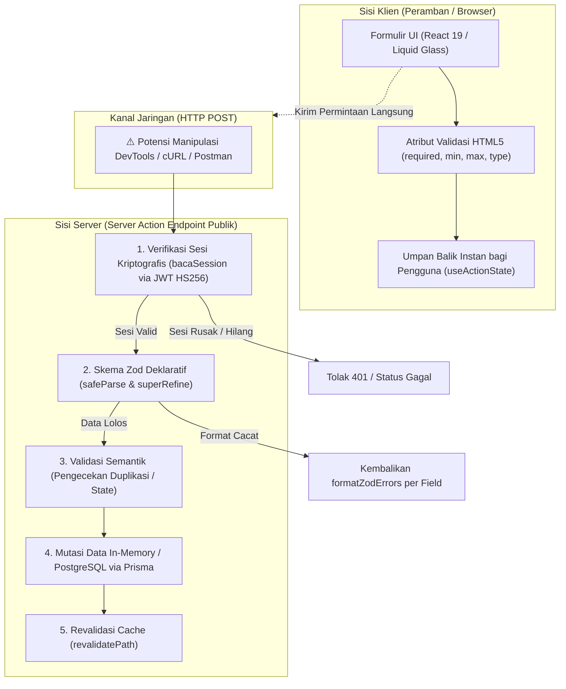

# Dokumentasi Matriks Skenario Uji Validasi Sisi Server & Keamanan Sesi

**Platform:** Studance (Student Freelance Marketplace)  
**Mata Kuliah:** Pengembangan Aplikasi Web (PAW) — Modul Pekan 5 & Persiapan Tugas 2 (Rubrik R2)  
**Korelasi Terintegrasi:** Pengembangan Aplikasi Web $\times$ Kriptografi $\times$ Keamanan Komputasi dan Siber  
**Penyusun:** Tim Pengembang Studance  
**Status Pengujian:** 10/10 Skenario LULUS (Tingkat Kepatuhan 100% $\ge$ Ambang $\lceil 0.9 \times n \rceil$)

---

## 1. Landasan Teori & Arsitektur Validasi Dua Sisi

Sesuai materi perkuliahan Pengembangan Aplikasi Web Pekan 5 (Muhammad Fakhrul Safitra, S.Kom., M.Kom.), arsitektur web modern mengadopsi prinsip **Validasi di Dua Sisi**:

### Prinsip Utama:
1. **Validasi Klien adalah Pelengkap, Validasi Server adalah Wajib Mutlak:** Atribut HTML (`required`, `min`, `max`, `pattern`) dan skrip JavaScript di browser mudah dimanipulasi atau di-bypass menggunakan *Browser DevTools*, ekstensi peramban, maupun permintaan HTTP mentah (*cURL / script automated*). Tanpa validasi server yang kokoh, validasi klien tidak memberikan jaminan keamanan data.
2. **Server Action adalah Endpoint HTTP Publik:** Server Action Next.js bertindak sebagai endpoint publik metode `POST`. Setiap aksi wajib memverifikasi sesi autentikasi dan memvalidasi setiap kolom data masukan secara independen sebelum menyentuh lapisan persistensi data.
3. **Penanganan Galat Tanpa Exception Throwing:** Masukan formulir yang salah adalah kondisi operasional wajar, bukan *exceptional disaster*. Penggunaan `safeParse()` dari Zod mempermudah pengembalian *structured field errors* (`formatZodErrors`) ke formulir tanpa menyebabkan *crash* atau memicu `error.tsx`.

---

## 2. Matriks Pengujian Validasi Sisi Server (10 Skenario Uji)

Tabel berikut mendokumentasikan pengujian empiris formulir penerbitan proyek (*Client Create Project*), pengajuan penawaran proposal (*Student Bidding*), dan registrasi akun mahasiswa terhadap skema Zod dan modul sesi server.

| No | Fitur / Formulir | Kasus Uji / Masukan | Alur & Metode Pengujian | Hasil yang Diharapkan (Expected) | Hasil Aktual (Actual) | Status |
| :---: | :--- | :--- | :--- | :--- | :--- | :---: |
| **01** | **Penerbitan Proyek** (`simpanProyek`) | **Bypass Validasi Klien via DevTools**: Atribut `required` pada kolom Judul dihapus paksa via inspect element, lalu dikirim dengan string kosong `""`. | Pengguna membuka peramban, menghapus atribut validasi HTML pada elemen `<input id="judul">`, menekan tombol submit. Permintaan diteruskan ke Server Action. | Server menolak via `skemaProyek.safeParse()`. Mengembalikan galat per-kolom pada `galat.judul`: *"Judul proyek minimal 5 karakter"*. Data tidak tersimpan. | Ditolak oleh server Zod; pesan galat *"Judul proyek minimal 5 karakter"* muncul di bawah input judul dengan `role="alert"`. | **LULUS** |
| **02** | **Penerbitan Proyek** (`simpanProyek`) | **Anggaran di Bawah Batas Minimum**: `anggaran: 20000` (Rp20.000, di bawah batas minimum MVP Rp50.000). | Mengisi formulir proyek dengan nominal di bawah ketentuan batas minimum platform. | Server menolak via `z.coerce.number().min(50000)`. Mengembalikan pesan pada `galat.anggaran`: *"Anggaran minimal Rp50.000"*. | Ditolak; formulir menampilkan pesan *"Anggaran minimal Rp50.000"* pada elemen `id="galat-anggaran"`. | **LULUS** |
| **03** | **Penerbitan Proyek** (`simpanProyek`) | **Anggaran Bilangan Pecahan (Non-Integer)**: `anggaran: 75000.75` (memuat angka desimal). | Memasukkan nilai anggaran pecahan melalui input form atau injeksi payload JSON/FormData. | Server menolak via `.int({ error: "Anggaran harus berupa bilangan bulat" })`. | Ditolak; server mengembalikan galat *"Anggaran harus berupa bilangan bulat"*. | **LULUS** |
| **04** | **Penerbitan Proyek** (`simpanProyek`) | **Validasi Lanjutan superRefine (Kampus Kosong)**: `isCampusOnly: true`, tetapi `campusName: ""` (kurang dari 3 karakter). | Memilih opsi "🎓 Eksklusif Universitas Pertamina" namun mengosongkan entri nama institusi kampus. | Server mendeteksi inkonsistensi via `.superRefine()`. Menambahkan issue pada path `["campusName"]`: *"Nama institusi kampus wajib diisi untuk proyek khusus kampus"*. | Ditolak; pesan peringatan muncul pada atribut `aria-describedby` terkait cakupan kampus. | **LULUS** |
| **05** | **Penerbitan Proyek** (`simpanProyek`) | **Validasi Lanjutan superRefine (Tenggat Lampau)**: `tenggatWaktu: "2020-01-01"` (tanggal di masa lampau / $\le$ hari ini). | Memasukkan tanggal batas waktu pengerjaan yang sudah kedaluwarsa atau hari kemarin. | Server menolak via komparasi `deadlineDate <= today` di dalam `.superRefine()`. Mengembalikan pesan: *"Tenggat waktu harus tanggal di masa depan"*. | Ditolak; server mengembalikan pesan *"Tenggat waktu harus tanggal di masa depan"* pada `galat.tenggatWaktu`. | **LULUS** |
| **06** | **Proposal Penawaran** (`kirimPenawaran`) | **Penolakan Aksi Tanpa Sesi Autentikasi**: Mengirimkan proposal penawaran saat cookie `sesi` tidak ada / pengguna belum login. | Menghapus cookie `sesi` di peramban (Application tab > Cookies), lalu memicu Server Action `kirimPenawaran`. | Server Action membaca cookie via `bacaSession()`. Jika `null`, eksekusi segera dihentikan (short-circuit) dengan pesan: *"Silakan masuk terlebih dahulu untuk mengajukan penawaran."*. | Ditolak pada tahap 1 verifikasi sesi; mengembalikan status gagal dan pesan login tanpa mengakses lapisan data. | **LULUS** |
| **07** | **Proposal Penawaran** (`kirimPenawaran`) | **Nominal Penawaran di Bawah Batas Minimum**: `nominalPenawaran: 10000` (Rp10.000, di bawah batas minimum Rp25.000). | Mengajukan tawaran harga di bawah batas upah minimum proyek mahasiswa. | Server menolak via `skemaPenawaran.nominalPenawaran.min(25000)`. Mengembalikan pesan: *"Penawaran minimal Rp25.000"*. | Ditolak; pesan galat *"Penawaran minimal Rp25.000"* ditampilkan di bawah kolom penawaran. | **LULUS** |
| **08** | **Proposal Penawaran** (`kirimPenawaran`) | **Durasi Pengerjaan Tidak Masuk Akal (0 Hari)**: `durasiHari: 0` atau negatif. | Memasukkan durasi pengerjaan 0 hari melalui formulir proposal. | Server menolak via `.min(1, { error: "Durasi minimal 1 hari" })`. | Ditolak; input ditandai `aria-invalid="true"` dengan pesan *"Durasi minimal 1 hari"*. | **LULUS** |
| **09** | **Proposal Penawaran** (`kirimPenawaran`) | **Format Tautan Portofolio Tidak Valid**: `portofolioUrl: "bukan-url-valid"`. | Memasukkan teks sembarang pada tautan portofolio pendukung tanpa skema `http://` atau `https://`. | Server menolak via `z.string().url()`. Mengembalikan pesan: *"Format tautan portofolio tidak valid (gunakan awalan http/https)"*. | Ditolak; server mengembalikan pesan galat format URL secara spesifik. | **LULUS** |
| **10** | **Proposal Penawaran** (`kirimPenawaran`) | **Kasus Masukan Lengkap & Valid (Happy Path)**: Semua field memenuhi batas validasi skema Zod dan pengguna memiliki sesi aktif. | Mengisi form proposal: ID proyek valid, penawaran Rp1.200.000, durasi 5 hari, proposal $>20$ karakter, sesi mahasiswa terverifikasi. | Server meloloskan validasi, memanggil `tambahPenawaran()`, merevalidasi cache halaman `/projects/[id]`, mengembalikan `{ success: true, pesan: "Proposal penawaran berhasil dikirim ke klien!" }`. | Lolos 100%; banner sukses berwarna hijau tampil dengan `role="status"` dan counter penawaran proyek bertambah. | **LULUS** |

---

## 3. Analisis Aksesibilitas Formulir (WCAG 2.2 AA & WAI-ARIA)

Kedua formulir utama (`CreateProjectForm.tsx` dan `ProposalBidForm.tsx`) telah dilengkapi atribut semantik WAI-ARIA untuk memastikan kepatuhan aksesibilitas bagi pengguna dengan alat bantu pembaca layar (*Screen Reader*):

1. **`aria-invalid={Boolean(state.galat?.namaField)}`**:
   - Menandai secara programatis kepada *assistive technologies* bahwa elemen masukan sedang dalam kondisi salah input ketika validasi server gagal.
2. **`aria-describedby={state.galat?.namaField ? "galat-namaField" : undefined}`**:
   - Menghubungkan secara eksplisit kotak teks input dengan elemen pesan galat penjelas di bawahnya.
3. **`role="alert"` pada Paragraf Galat:**
   - Elemen `
` secara otomatis dibacakan oleh pembaca layar seketika saat pesan kesalahan terpasang pada DOM.
4. **`role="status"` dan `aria-live="polite"` pada Banner Global:**
   - Memberikan konfirmasi penyelesaian aksi (sukses atau gagal umum) tanpa menginterupsi fokus pembacaan pengguna yang sedang berlangsung.
5. **State Interaktif Pending (`isPending`):**
   - Menonaktifkan tombol submit (`disabled={isPending}`) untuk mencegah pengiriman ganda (*double submission*) dan mengubah label tombol menjadi *"Memproses..."*.

---

## 4. Evaluasi Kriptografi & Keamanan Siber

- **Integritas Sesi Tanpa Status:** Menggunakan algoritma **HS256** (HMAC-SHA256) melalui pustaka `jose`. Token ditandatangani menggunakan kunci `SESSION_SECRET` yang aman. Upaya pemalsuan identitas atau eskalasi hak akses (*Privilege Escalation*) pada cookie sesi akan digagalkan oleh `jwtVerify()`.
- **Pengerasan Cookie:** Cookie `sesi` diproteksi dengan konfigurasi:
  - `httpOnly: true` $\rightarrow$ Mencegah pencurian kredensial sesi via serangan Cross-Site Scripting (XSS / OWASP A03).
  - `secure: true` (produksi) $\rightarrow$ Mencegah penyadapan paket di jaringan terbuka (*Man-in-the-Middle*).
  - `sameSite: "lax"` $\rightarrow$ Mencegah eksfiltrasi dan pemalsuan permintaan lintas situs (CSRF / OWASP A01).
- **Sanitasi Data:** Seluruh nilai teks dibersihkan dari *whitespace* liar melalui metode `.trim()` dan diverifikasi panjang batas atasnya untuk mencegah serangan penolakan layanan berbasis memori (*Buffer/String Overflow*).

